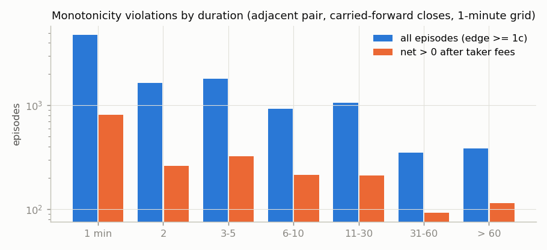
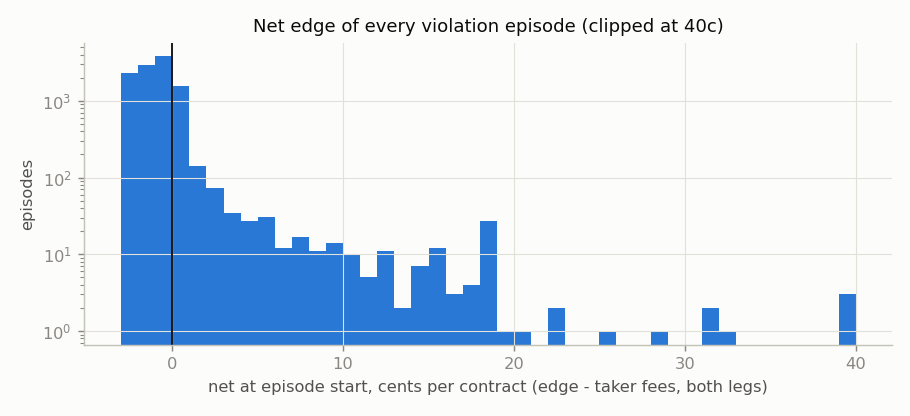
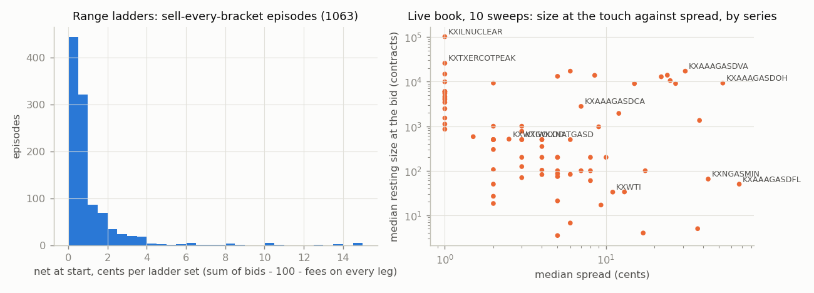
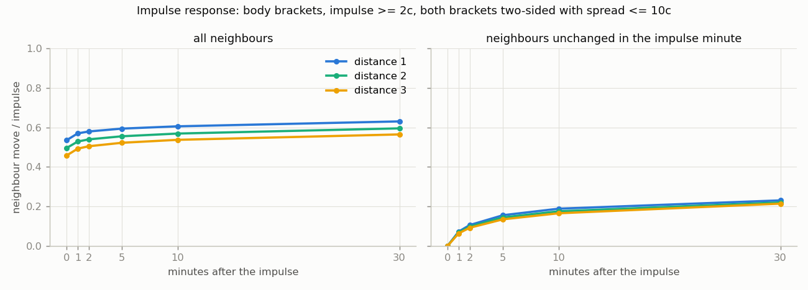
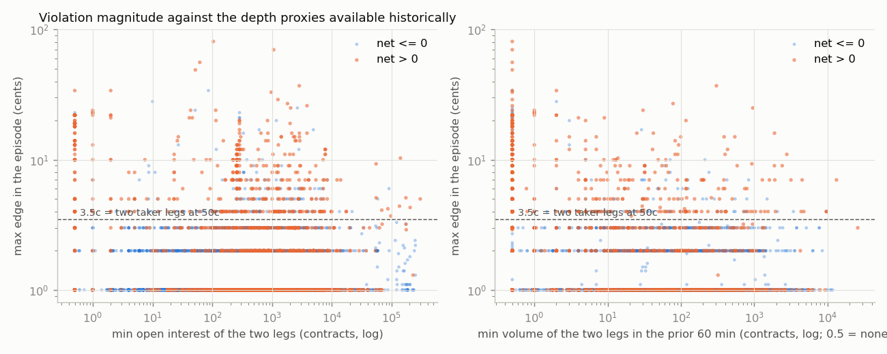

# FINDINGS_LADDER_DYNAMICS — the Kalshi ladder against itself

Generated 2026-10-05 23:17 UTC from the Kalshi store (`data/parquet/kalshi_candles`, 1-minute candles to 2026-09-10) by `python3 -m ladder.run` and `python3 -m ladder.report`. Brief: `NightKing/HANDOFF_ladder_dynamics.md`. Code: `ladder/`. Results: `ladder/results/`, plots `ladder/plots/`.

Jobs: 2194 events ok, 0 failed (`ladder/results/status.jsonl`, last attempt per event). Cumulative ladders 1439, range ladders 755 (4 of them pulled live for October); 196 events skipped as not a ladder (157 single-market events, custom strikes), 184 ladders without stored candles.

## Verdict

**Shape violations are real, rare, one-tick deep and short, and the two-leg trade does not clear fees except in dead markets.** Across 211M adjacent-pair-minutes on 1435 cumulative ladders, an executable monotonicity violation (buy the lower threshold for less than you can sell the higher one, carried-forward 1-minute closes) exists on 0.091% of pair-minutes and 0.77% of ladder-minutes. There are 10,974 episodes; the median lasts 2 minutes, 43% last one minute, and the modal maximum edge is exactly 1c (77% of episodes). After taker fees on both legs 2,021 episodes (18.4%) are net positive, with a median net of 0.42c; the net-positive ones live almost entirely in thin yearly / monthly markets (AAA state-gas yearly highs and lows, natural gas yearly min/max, WTI monthly min/max) where the open interest of a leg is in the tens or hundreds and the violation is a resting order nobody has bothered to lift. Only 107 episodes have net >= 2c with at least 500 contracts of open interest on both legs; none of them is in a daily or weekly commodity ladder with a live market maker, and their resting size at the touch is unknown historically.

**Propagation is immediate where it is tradeable and absent where it is not.** When a body bracket moves >= 2c, the adjacent bracket moves in the same minute 62% of the time; a neighbour that did not move in that minute recovers only 16% of the impulse after 5 minutes and 23% after 30, and buying it at the ask (selling at the bid) on the impulse and unwinding at the touch 5 minutes later loses 5.5c on average and is positive 5% of the time. The stale neighbour is stale because its spread is wide, not because it is slow.

**Nothing clears friction and capital together. The only thing that clears fees is not a shape violation but the sum constraint on the 2026 weekly WTI range ladder.** On KXWTIW in 2026 the sum of the bids across all brackets exceeds 100c plus the fee on every leg on 7,112 of the 335,014 minutes on which every bracket had a bid (2.1%): 1,032 episodes, median net 0.60c per ladder set (every bracket sold once), p90 2.1c, max 13.0c, median duration 2 minutes, p90 12. It is a 15-leg trade whose profit is locked at settlement, and it exists because the far brackets carry resting 1-2c bids that do not move when the body reprices; the live book (section 6) shows 500-1,000 contracts resting at those bids, so size is not the objection. Capital is: selling every bracket posts sum(100 - bid) ≈ $13.9 of collateral per set, so the median episode returns 0.043% and the p90 0.15% on collateral tied up until the Friday settlement. That clears fees and fails any capital hurdle unless Kalshi nets collateral across the brackets of one event, which this study did not verify. It is the one candidate and it is small.

**The 1-minute resolution is binding for the shape question.** Comparing intra-minute extremes (the higher bracket's best bid against the lower bracket's best ask within the same minute, only where both printed a candle) finds crossings on 0.30% of such pair-minutes versus 0.091% on closes, so sub-minute crossings are 3x more common than end-of-minute ones; that is an upper bound (the extremes need not coexist) and it cannot be tightened from candles. What can be said: a 1-minute-resolved violation is overwhelmingly one tick and one minute.

## 0. Data construction, checked before anything else

- **The store is sparse by design.** A 1-minute candle exists only for minutes in which the top of book changed: across all 58.9M candles the open of a bracket's next candle equals the close of its previous one 99.95% of the time (bid 99.953%, ask 99.956%). A missing minute is therefore 'the book did not move', not 'the book was not observed', and every analysis below carries the last close forward to the minute grid. Median gap between candles is 60 s on the daily ladders and 2-4 min on monthlies; p90 is 4-13 min.
- **Empty sides.** The API encodes no bid as 0 and no ask as 100; both are treated as no quote (NaN) and the no-quote state is carried forward like any other.
- **Intra-minute extremes exist.** On KXNATGASD 47% of candles have bid_high != bid_close, so a candle minute often contains several book updates; the 'intra' view uses them as an upper bound.
- **Ladder kinds** come from the markets table (strike_type), with a title parser for the 2022-24 markets that carry none ('$77 to 77.99', '1624.99 or below'). 'Less' ladders (yearly/monthly lows: KXWTIMIN, KXNGASMIN, ...) are flipped to P(>X) form so the monotone constraint is always 'non-increasing in the strike' and the trade is the same two legs.
- **Executable prices only.** Edge = bid(X_j) - ask(X_i) from the stored bid/ask closes; the spread is crossed by construction and the only remaining friction is the taker fee on each leg, 0.07 x P(1-P) per contract, rounded up to the cent per order (verified: every ladder series reports fee_type quadratic, multiplier 1 on the series endpoint). The displayed 'chance' and the mid are never used for an edge.
- **Thresholds, stated in advance.** A violation is an executable edge >= 1c (one tick); sensitivity at 2, 3, 5c. A 'move' is a mid change >= 2c between consecutive minutes on a two-sided bracket with spread <= 10c on both minutes; sensitivity at 1c and 5c. Body = mid in [10c, 90c], tail otherwise. Duration = consecutive grid minutes with the edge >= 1c, so '1 minute' means 'seen on one close and gone on the next'.
- **Depth is not in the candles.** Resting size at the touch is reported from the live collector (section 6); historically the only proxies are open interest and recent traded volume of the two legs, and they are labelled as proxies.

## 1. Violation census — cumulative ladders (1435 ladders, 43,041 brackets)

Denominator: 211,491,778 adjacent-pair-minutes with both legs quoted on the side the trade hits (24,038,015 ladder-minutes); 32,067,661 pair-minutes where both brackets printed a candle (the intra-minute view). 'Any pair' takes the best j > i, not only the adjacent one.

| threshold | pair_minutes_close | pct_pair_close | ladder_minutes_close | pct_ladder_close | pair_minutes_any_pair | pair_minutes_intra | pct_pair_intra |
|---|---|---|---|---|---|---|---|
| ≥ 1c | 192,167 | 0.091 | 184,853 | 0.769 | 246,116 | 95,709 | 0.298 |
| ≥ 2c | 62,460 | 0.030 | 61,021 | 0.254 | 97,806 | 46,846 | 0.146 |
| ≥ 3c | 27,293 | 0.013 | 26,456 | 0.110 | 47,125 | 28,496 | 0.089 |
| ≥ 5c | 13,163 | 0.006 | 12,659 | 0.053 | 27,785 | 14,142 | 0.044 |

Mid-based shape violations (mid of the higher strike above the mid of the lower, both spreads <= 10c) occur on 5.15% of tight pair-minutes — the ladder's *shape* is wrong at the mid 60x more often than it is executably wrong, which is the maker-side number of section 5.

### By series (top 30 by pair-minutes; all 162 in `ladder/results/summary.parquet`)

| series | ladders | pair-min (M) | median spread c | % pair-min violated | % ladder-min violated | % intra-min crossed | episodes | net>0 episodes |
|---|---|---|---|---|---|---|---|---|
| KXWTI | 133 | 18.250 | 2.000 | 0.048 | 1.199 | 0.220 | 1142 | 204 |
| KXNATGASD | 92 | 12.080 | 4.000 | 0.085 | 3.495 | 0.783 | 2535 | 215 |
| KXWTIMAX | 7 | 8.730 | 10.000 | 0.208 | 0.985 | 0.272 | 241 | 38 |
| KXSILVERD | 95 | 8.060 | 3.000 | 0.067 | 1.936 | 0.329 | 952 | 193 |
| KXGOLDD | 95 | 7.550 | 3.000 | 0.052 | 1.420 | 0.259 | 659 | 136 |
| KXGOLDMON | 7 | 7.440 | 4.000 | 0.018 | 0.472 | 0.045 | 98 | 17 |
| KXAAAGASM | 29 | 7.130 | 3.000 | 0.216 | 1.173 | 0.416 | 238 | 16 |
| KXSILVERMON | 6 | 6.910 | 5.500 | 0.035 | 1.012 | 0.076 | 148 | 8 |
| KXGOLDW | 26 | 6.750 | 3.000 | 0.039 | 1.003 | 0.133 | 255 | 57 |
| KXCOPPERMON | 6 | 6.350 | 7.500 | 0.022 | 0.592 | 0.194 | 162 | 7 |
| KXCOPPERD | 94 | 6.190 | 4.000 | 0.055 | 1.302 | 0.422 | 554 | 91 |
| KXSILVERW | 26 | 5.280 | 3.000 | 0.023 | 0.492 | 0.092 | 120 | 32 |
| KXCOPPERW | 21 | 5.130 | 4.000 | 0.045 | 1.134 | 0.188 | 304 | 15 |
| KXBRENTD | 97 | 5.050 | 3.000 | 0.064 | 1.185 | 0.298 | 439 | 161 |
| KXWTIMIN | 7 | 4.600 | 5.000 | 0.057 | 0.180 | 0.154 | 116 | 8 |
| KXBRENTMON | 6 | 4.200 | 4.000 | 0.051 | 0.921 | 0.145 | 122 | 31 |
| KXNATGASMON | 6 | 4.130 | 5.500 | 0.013 | 0.237 | 0.058 | 60 | 7 |
| KXOILRIGS | 2 | 3.980 | 6.500 | 0.000 | 0.002 | 0.006 | 1 | 1 |
| KXSOLAR | 2 | 3.370 | 7.500 | 0.000 | 0.000 | 0.006 | 0 | 0 |
| KXAAAGASMAX | 2 | 3.350 | 12.500 | 0.108 | 0.654 | 0.468 | 87 | 20 |
| KXBRENTW | 24 | 3.270 | 2.000 | 0.011 | 0.156 | 0.090 | 61 | 24 |
| KXAAAGASMAXCA | 3 | 3.180 | 35.000 | 0.362 | 1.357 | 1.397 | 242 | 63 |
| KXNATGASW | 23 | 2.930 | 3.000 | 0.001 | 0.007 | 0.018 | 5 | 4 |
| KXAAAGASMAXTX | 4 | 2.870 | 9.500 | 0.119 | 0.448 | 0.960 | 275 | 42 |
| KXAAAGASMINTX | 3 | 2.800 | 7.000 | 0.265 | 0.656 | 0.315 | 80 | 15 |
| KXNGASMAX | 5 | 2.680 | 10.000 | 0.209 | 0.670 | 0.085 | 24 | 4 |
| KXAAAGASED | 1 | 2.550 | 7.000 | 0.026 | 0.263 | 0.181 | 12 | 1 |
| KXAAAGASMINCA | 3 | 2.390 | 8.000 | 0.170 | 0.324 | 0.801 | 106 | 12 |
| KXAAAGASMIN | 2 | 2.390 | 9.000 | 0.164 | 0.860 | 0.381 | 21 | 4 |
| KXUSGASCPI | 6 | 2.330 | 12.500 | 0.040 | 0.290 | 0.490 | 172 | 32 |

### Episodes (10,974, adjacent pair, edge >= 1c on carried-forward closes)

| duration | all | share | net > 0 | edge >= 3c |
|---|---|---|---|---|
| 1 min | 4,817 | 43.9% | 806 | 315 |
| 2 | 1,636 | 14.9% | 262 | 159 |
| 3-5 | 1,811 | 16.5% | 322 | 197 |
| 6-10 | 921 | 8.4% | 213 | 122 |
| 11-30 | 1,055 | 9.6% | 212 | 158 |
| 31-60 | 352 | 3.2% | 92 | 56 |
| > 60 | 382 | 3.5% | 114 | 101 |

Maximum edge inside the episode: 1c 77.6%, 2c 12.3%, 3-5c 6.8%, 6-10c 1.8%, > 10c 1.4% (159 episodes above 10c, largest 81c: KXNGASMIN KXNGASMIN-26DEC31 2.60/2.80, 761 minutes, a 2c ask resting against an 83c bid on a yearly natural-gas low ladder with no trades in the hour before).

Net of taker fees on both legs at the start of the episode: median -0.83c, p90 0.40c, p99 8.69c; 2,021 (18.4%) positive, 453 (4.1%) >= 1c, 312 (2.8%) >= 2c, 178 >= 5c. Of the net-positive episodes 69% are between tail brackets (one leg with mid < 10c or > 90c), where the fee is a few tenths of a cent: a 1c edge at 5c prices clears fees, at 50c prices it does not.

Who creates and who resolves: the violation starts with a fresh print on both legs in 60% of episodes, on the lower leg only 18%, the higher leg only 22%; it ends with a print on both 68%, lower only 15%, higher only 18% (ended episodes). Violations are a by-product of simultaneous repricing, not of one bracket drifting.

Timing: 45% of episodes start between 12:00 and 20:00 UTC (US trading hours; the store is UTC); the median episode starts 31 hours before the ladder closes (p25 10 h, p75 520 h).

### Net-positive episodes by series (top 20)

| series | n | median min | max min | median net c | max net c | median OI (higher leg) | median 60-min vol |
|---|---|---|---|---|---|---|---|
| KXNATGASD | 215 | 2 | 99 | 0.49 | 20.66 | 570.20 | 83.24 |
| KXWTI | 204 | 1 | 87 | 0.66 | 16.91 | 1164.51 | 30.50 |
| KXSILVERD | 193 | 2 | 152 | 0.40 | 6.54 | 455.00 | 28.00 |
| KXBRENTD | 161 | 1 | 129 | 0.27 | 13.61 | 1829.80 | 200.00 |
| KXGOLDD | 136 | 3 | 90 | 0.40 | 3.70 | 780.62 | 103.79 |
| KXWTIMINM | 108 | 2 | 111 | 0.40 | 33.97 | 262.56 | 8.60 |
| KXAAAGASW | 94 | 2 | 191 | 0.46 | 22.01 | 3917 | 163.33 |
| KXCOPPERD | 91 | 2 | 112 | 0.27 | 2.81 | 393.24 | 26.97 |
| KXAAAGASMAXCA | 63 | 11 | 1033 | 1.47 | 30.82 | 4938.63 | 3.00 |
| KXGOLDW | 57 | 4 | 194 | 0.53 | 1.85 | 479.77 | 25.00 |
| KXAAAGASMAXFL | 51 | 22 | 1843 | 1.21 | 11.57 | 928.53 | 0.00 |
| KXAAAGASMAXTX | 42 | 7.50 | 671 | 0.92 | 25.84 | 2036.92 | 0.00 |
| KXGOLDDIRY | 39 | 2 | 138 | 14.78 | 21.52 | 0.00 | 0.00 |
| KXWTIMAX | 38 | 2 | 12,756 | 0.66 | 7.44 | 4761.99 | 85.75 |
| KXAAAGASD | 36 | 2 | 11 | 0.40 | 0.79 | 1505.73 | 106.50 |
| KXWTIMAXM | 35 | 1 | 34 | 1.53 | 18.87 | 1.00 | 0.00 |
| KXSILVERW | 32 | 2 | 111 | 0.27 | 1.66 | 458.05 | 0.00 |
| KXUSGASCPI | 32 | 2.50 | 58 | 0.74 | 18.87 | 5.01 | 0.00 |
| KXBRENTMON | 31 | 2 | 73 | 0.27 | 3.53 | 10818.31 | 113.00 |
| KXAAAGASMINFL | 25 | 33 | 631 | 1.69 | 13.38 | 2426.45 | 0.00 |

### The largest net-positive episodes with open interest >= 500 on both legs

| series | event | strike_i | strike_j | min | edge_max | net_start | spread_i | spread_j | mid_i | mid_j | vol60_i | vol60_j | oi_i | oi_j |
|---|---|---|---|---|---|---|---|---|---|---|---|---|---|---|
| KXWTIMINM | KXWTIMINM-26APR30 | 84.0 | 86.0 | 29 | 37.0 | 33.0 | 25.0 | 9.0 | 16.5 | 69.5 | 1054 | 304.8 | 2846.7 | 5964.6 |
| KXAAAGASMAXCA | KXAAAGASMAXCA-26DEC31 | 7.6 | 7.8 | 121 | 33.0 | 28.8 | 20.0 | 1.0 | 51.0 | 92.5 | 0.0 | 0.0 | 7410.1 | 969.4 |
| KXAAAGASMAXTX | KXAAAGASMAXTX-26DEC31 | 4.8 | 5.0 | 1 | 29.0 | 25.8 | 1.0 | 10.0 | 40.5 | 75.0 | 9.0 | 0.0 | 1365.3 | 1252.9 |
| KXAAAGASMAXCA | KXAAAGASMAXCA-26DEC31 | 6.8 | 7.0 | 1 | 26.0 | 22.9 | 36.0 | 3.0 | 28.0 | 73.5 | 170.0 | 0.0 | 3838.2 | 5252.1 |
| KXAAAGASW | KXAAAGASW-26MAY11 | 4.5 | 4.5 | 2 | 25.0 | 22.0 | 5.0 | 5.0 | 49.5 | 79.5 | 954.3 | 1406.3 | 13208.8 | 2043.4 |
| KXAAAGASMAXTX | KXAAAGASMAXTX-26DEC31 | 4.4 | 4.6 | 49 | 19.0 | 17.3 | 2.0 | 1.0 | 74.0 | 94.5 | 0.0 | 20.0 | 2127.3 | 1999.8 |
| KXAAAGASMAXCA | KXAAAGASMAXCA-26DEC31 | 7.6 | 7.8 | 90 | 20.0 | 17.2 | 2.0 | 14.0 | 59.0 | 87.0 | 0.0 | 0.0 | 7295.2 | 839.4 |
| KXBRENTD | KXBRENTD-26APR2117 | 98.0 | 98.5 | 1 | 16.0 | 13.6 | 10.0 | 5.0 | 64.0 | 87.5 | 2002.2 | 1889.3 | 2134.1 | 2171.7 |
| KXAAAGASMINFL | KXAAAGASMINFL-26DEC31 | 2.5 | 2.6 | 4 | 15.0 | 12.9 | 1.0 | 1.0 | 72.5 | 88.5 | 26.0 | 7.0 | 2869.7 | 6039.7 |
| KXAAAGASMAXCA | KXAAAGASMAXCA-26DEC31 | 7.6 | 7.8 | 140 | 16.0 | 12.8 | 16.0 | 24.0 | 46.0 | 82.0 | 18.3 | 0.0 | 7377.3 | 850.4 |
| KXAAAGASMAXCA | KXAAAGASMAXCA-26DEC31 | 6.6 | 6.8 | 13 | 15.0 | 12.6 | 1.0 | 1.0 | 69.5 | 85.5 | 643.0 | 388.0 | 1424.1 | 4411.5 |
| KXAAAGASMAXCA | KXAAAGASMAXCA-26DEC31 | 6.6 | 6.8 | 6 | 15.0 | 12.6 | 1.0 | 1.0 | 69.5 | 85.5 | 543.0 | 588.0 | 1424.1 | 4611.5 |

## 2. Range ladders — the sum constraint (755 ladders)

A range ladder's bracket price is itself a density value and is non-negative by construction, so there is no two-leg shape constraint; the constraint is the sum. 'Ask excess' = sum of asks - 100 (median over minutes with every bracket asked); 'bid short' = 100 - sum of bids. Buy-all / sell-all minutes count the minutes on which crossing every leg locks a profit, gross and net of the fee on every leg.

| series | ladders | minutes | all_bid | all_ask | ask_excess | bid_short | spread_sum | buy_gross | buy_net | sell_gross | sell_net |
|---|---|---|---|---|---|---|---|---|---|---|---|
| KXCOPPERMON | 1 | 38,225 | 13 | 38,163 | 189.0 | 38.0 | 231.0 | 0 | 0 | 0 | 0 |
| KXGOLD | 19 | 27,116 | 9189 | 11,563 | 327.2 | 60.0 | 357.5 | 0 | 0 | 21 | 19 |
| KXGOLDMON | 1 | 38,236 | 13 | 38,116 | 106.0 | 54.0 | 258.0 | 0 | 0 | 0 | 0 |
| KXSILVERMON | 1 | 38,249 | 981 | 38,127 | 100.0 | 60.0 | 3760 | 0 | 0 | 0 | 0 |
| KXSTEELMON | 1 | 1010 | 0 | 1010 | 3860 | - | - | 0 | 0 | 0 | 0 |
| KXWTI | 545 | 977,435 | 175,232 | 632,244 | 113.0 | 19.0 | 40.0 | 4 | 4 | 297 | 94 |
| KXWTIW | 187 | 1,672,371 | 335,014 | 1,016,785 | 102.0 | 23.0 | 52.0 | 2316 | 369 | 35,359 | 7112 |

| series | side | year | episodes | legs | net_med | net_p90 | net_max | dur_med | dur_p90 |
|---|---|---|---|---|---|---|---|---|---|
| KXGOLD | sell_all | 2022 | 17 | 5 | 13.87 | 26.44 | 40.32 | 1.00 | 1.40 |
| KXWTI | buy_all | 2024 | 2 | 15 | 22.15 | 38.99 | 44.26 | 2.00 | 2.80 |
| KXWTI | sell_all | 2022 | 7 | 10 | 2.75 | 8.47 | 8.59 | 1.00 | 2.00 |
| KXWTI | sell_all | 2024 | 6 | 15 | 0.70 | 1.45 | 4.41 | 1.00 | 40.50 |
| KXWTIW | buy_all | 2026 | 15 | 15 | 0.49 | 2.59 | 8.49 | 3.00 | 36.80 |
| KXWTIW | sell_all | 2024 | 1 | 15 | 3.46 | 3.46 | 3.46 | 985.00 | 985.00 |
| KXWTIW | sell_all | 2026 | 1032 | 15 | 0.60 | 2.14 | 12.97 | 2.00 | 12.90 |

The 2026 KXWTIW sell-all episodes are the whole story here: the 2026 ladders have 15-27 brackets, the body is quoted 1-3c wide by a market maker, and the far brackets carry resting 1-2c bids. When the body reprices upward the sum of the bids tips over 100c plus fees for a couple of minutes. Selling every bracket (buying NO on each) pays 100c at settlement against a median 106c collected, so the profit is locked; the collateral is sum(100 - bid) ≈ $13.9 per set for a median 0.60c net. Net >= 2c on 120 episodes, >= 5c on 18. Whether the tail bids hold 500 contracts when hit, and whether all 15 legs fill in the same minute, is exactly what the live collector is for.

## 3. Propagation — impulse response on cumulative ladders

Impulses (>= 2c on a tight body bracket): 1,687,113; on tail brackets 245,389. Same-minute co-movement of the neighbour at distance k (any tick, body initiator): k=±1 62%, ±2 55%, ±3 50%; at >= 5c impulses 72% / 63% / 58%; at >= 1c 45% / 40% / 36%.

Response = neighbour's cumulative mid move from the minute before the impulse to h minutes after, divided by the impulse; same-sign = share of neighbours that moved the same way. On a P(>X) ladder a parallel shift moves every bracket together, but neighbouring thresholds carry less density than the initiator, so a full response is well below 1 and the level is not the point — the *lag* is. Body initiator, body neighbour, k = +1 (the next-higher strike):

**All neighbours** (thr 2c):

| h | n | response | same_sign |
|---|---|---|---|
| 0 | 1,104,343 | 0.694 | 0.904 |
| 1 | 1,104,343 | 0.718 | 0.810 |
| 2 | 1,104,343 | 0.720 | 0.767 |
| 5 | 1,104,343 | 0.724 | 0.708 |
| 10 | 1,104,343 | 0.731 | 0.669 |
| 30 | 1,104,343 | 0.751 | 0.614 |

**Neighbours unchanged in the impulse minute** (thr 2c), with the stale-neighbour trade: buy at the ask (impulse up) or sell at the bid (impulse down) at t, unwind at the touch at t+h, net of taker fees on both legs:

| h | n | response | same_sign | trade_n | trade_mean_c | trade_pos |
|---|---|---|---|---|---|---|
| 0 | 330,327 | 0.000 | 0.000 | 330,327 | -5.769 | 0.000 |
| 1 | 330,327 | 0.073 | 0.176 | 330,301 | -5.670 | 0.014 |
| 2 | 330,327 | 0.105 | 0.231 | 330,283 | -5.615 | 0.025 |
| 5 | 330,327 | 0.156 | 0.308 | 330,209 | -5.541 | 0.050 |
| 10 | 330,327 | 0.190 | 0.359 | 330,076 | -5.507 | 0.077 |
| 30 | 330,327 | 0.234 | 0.424 | 329,337 | -5.499 | 0.132 |

Sensitivity, stale body neighbour at h = 5 / 30: thr 1c response 0.16 / 0.25, trade mean -5.9c / -6.0c, positive 2% / 8%; thr 5c response 0.16 / 0.24, trade mean -4.7c / -4.3c, positive 12% / 22%. Body impulse onto a stale tail neighbour (thr 2c): response 0.07 at h=5, 0.10 at h=30, trade mean -3.0c, positive 13% at h=30. Tail impulse onto a stale body neighbour: response 0.14 at h=30, trade mean -5.2c.

By series (thr 2c, k=+1, body→body, h=5):

| series | impulses | co_move | stale_n | stale_resp_5 | stale_trade_5 | stale_pos_5 | moved_resp_5 |
|---|---|---|---|---|---|---|---|
| KXNATGASD | 283,785 | 0.828 | 23,921 | 0.354 | -4.638 | 0.117 | 0.887 |
| KXWTI | 269,150 | 0.519 | 68,529 | 0.155 | -5.418 | 0.049 | 0.612 |
| KXSILVERD | 213,053 | 0.737 | 29,288 | 0.278 | -4.522 | 0.096 | 0.809 |
| KXGOLDD | 162,588 | 0.690 | 25,045 | 0.275 | -4.605 | 0.088 | 0.828 |
| KXBRENTD | 140,302 | 0.663 | 23,715 | 0.263 | -4.838 | 0.077 | 0.776 |
| KXCOPPERD | 118,637 | 0.728 | 16,542 | 0.166 | -4.692 | 0.073 | 0.695 |
| KXCOPPERW | 53,170 | 0.694 | 8616 | 0.113 | -5.101 | 0.034 | 0.583 |
| KXGOLDW | 47,513 | 0.567 | 10,185 | 0.163 | -5.369 | 0.038 | 0.662 |
| KXAAAGASW | 41,128 | 0.242 | 9644 | 0.065 | -5.944 | 0.020 | 0.381 |
| KXSILVERW | 34,450 | 0.517 | 7797 | 0.137 | -5.185 | 0.036 | 0.622 |
| KXBRENTMON | 32,900 | 0.232 | 14,350 | 0.034 | -6.478 | 0.005 | 0.206 |
| KXSILVERMON | 32,482 | 0.437 | 10,325 | 0.040 | -7.229 | 0.007 | 0.448 |
| KXAAAGASM | 31,878 | 0.216 | 9119 | 0.044 | -6.003 | 0.011 | 0.442 |
| KXAAAGASD | 31,348 | 0.324 | 8338 | 0.058 | -5.643 | 0.051 | 0.440 |
| KXBRENTW | 30,146 | 0.336 | 10,623 | 0.097 | -5.310 | 0.021 | 0.417 |
| KXGOLDMON | 23,511 | 0.393 | 8422 | 0.031 | -7.138 | 0.004 | 0.428 |
| KXCOPPERMON | 17,833 | 0.579 | 4423 | 0.026 | -7.499 | 0.010 | 0.467 |
| KXNATGASW | 10,460 | 0.316 | 2398 | 0.096 | -4.842 | 0.019 | 0.521 |
| KXNATGASMON | 9345 | 0.408 | 3198 | 0.017 | -7.245 | 0.002 | 0.331 |
| KXWTIMAX | 8017 | 0.164 | 4204 | 0.034 | -6.272 | 0.005 | 0.239 |

Does the body reprice before the tails? Tail neighbours co-move less (50% vs 62% at k=±1) and catch up less (0.10 vs 0.23 at h=30), but the stale-tail trade is just as negative: a tail bracket sits at a 1-3c price where the whole move is a tick or two and the spread is the tick.

## 4. Magnitude against depth

Historically the only depth proxies are the open interest of the two legs and the contracts traded in the previous hour. The scatter plots every episode's maximum edge against the smaller of the two legs' proxies, coloured by whether the start-of-episode net is positive; the dashed line is 3.5c, the two-leg taker fee at 50c prices (the fee stack is 0.3c per leg at 5c prices and 1.75c at 50c, so there is no single friction line in cents — the colour is the test).

| min_open_interest | episodes | edge_median | edge_p90 | net_pos_pct | net_ge_2c | vol60_zero_pct |
|---|---|---|---|---|---|---|
| < 100 | 2684 | 1.00 | 3.00 | 14.94 | 112 | 66.80 |
| 100-1,000 | 4936 | 1.00 | 2.00 | 18.35 | 118 | 43.31 |
| 1,000-10,000 | 3025 | 1.00 | 3.00 | 20.69 | 72 | 41.62 |
| >= 10,000 | 329 | 1.00 | 3.00 | 26.75 | 10 | 19.15 |

The expected tension holds with no middle: edges above a tick and nets above fees sit where the open interest is small and the prior hour traded nothing; where both legs have thousands of contracts of interest the violation is a tick for a minute and the fee eats it.

## 5. The maker number

Fair value = the monotone least-squares fit (pool-adjacent-violators, non-increasing in the strike) to the mids of the two-sided brackets with spread <= 20c, sampled every 10 minutes on every cumulative ladder: 1,635,485 ladder-minutes, 18,118,251 bracket-minutes. This is the ladder's own coherent shape, not an external model.

- The mids are non-monotone somewhere on the ladder on **32%** of sampled minutes.
- The fit sits strictly inside the bracket's own spread on 97.8% of bracket-minutes (it is a fit to the mids, so this is nearly tautological).
- **A maker could post one tick inside the spread and still be >= 1c on the right side of the fit on 58% of bracket-minutes** (bid side 56%, ask side 56%); the mean improvement available is 1.83c against a mean spread of 5.17c. Distribution of the room (cents): 0: 42%, 1: 20%, 2: 13%, 3-4: 16%, >= 5: 9%.
- With the maker coefficient (0.0175 x P(1-P), 0.44c at 50c) the room survives the fee on 38% of bracket-minutes; with maker fee zero the figure is the 58% above.

| series | minutes | nonmono_pct | improvable_pct | room_c | spread_c |
|---|---|---|---|---|---|
| KXAAAGASM | 104,180 | 16.93 | 43.06 | 1.20 | 4.02 |
| KXSOLAR | 83,907 | 0.39 | 88.10 | 2.35 | 6.65 |
| KXWTIMAX | 79,500 | 38.34 | 36.36 | 1.10 | 3.58 |
| KXWTI | 66,669 | 55.95 | 52.89 | 1.82 | 4.91 |
| KXOILRIGS | 64,480 | 5.57 | 89.59 | 2.46 | 6.87 |
| KXWTIMIN | 62,717 | 18.53 | 61.43 | 1.68 | 5.04 |
| KXAAAGASMINTX | 59,571 | 26.72 | 73.64 | 2.29 | 6.24 |
| KXBARRELS | 49,800 | 2.12 | 97.20 | 2.75 | 7.47 |
| KXRHGOLD | 49,057 | 1.47 | 82.41 | 1.87 | 5.69 |
| KXAAAGASMINCA | 43,922 | 36.14 | 84.08 | 2.96 | 7.32 |
| KXAAAGASMAXTX | 29,832 | 52.17 | 83.02 | 3.06 | 7.61 |
| KXAAAGASMAXFL | 29,627 | 44.74 | 79.15 | 2.76 | 6.95 |
| KXAAAGASW | 27,872 | 25.42 | 41.04 | 1.28 | 4.08 |
| KXAAAGASMINFL | 27,860 | 31.13 | 89.53 | 3.30 | 7.83 |
| KXAAAGASMAXCA | 27,637 | 54.88 | 84.66 | 2.91 | 7.31 |
| KXNGASMAX | 27,052 | 5.08 | 83.15 | 2.63 | 7.08 |
| KXGOLDD | 25,408 | 70.00 | 42.22 | 1.26 | 3.99 |
| KXSILVERD | 25,208 | 71.62 | 48.85 | 1.50 | 4.49 |
| KXBRENTD | 24,974 | 43.15 | 36.37 | 1.06 | 3.63 |
| KXGOLDMON | 24,944 | 80.14 | 64.68 | 1.91 | 5.44 |

Read with care: 'room' is relative to the ladder's own smoothed mids, which on a 5c-wide book is a weak fair value; it says a coherent quoter would often have been best bid or offer, not that being there is profitable. That is the question of the posting study the brief scopes out.

## 6. Live book: size at the touch (collector started 2026-10-05 22:49 UTC)

`ladder/collect_books.py` sweeps every open market of every series in the store once a minute from the open-markets listing (bid, ask, size at the touch, volume, OI per bracket; one request per series), and every fifth sweep pulls the full orderbook of the focus series. 10 sweeps so far covering 1,681 open markets in 113 series (16,810 rows, 12,466 two-sided).

| series | markets | spread_med | bid_size_med | ask_size_med | bid_size_p10 | ask_size_p10 |
|---|---|---|---|---|---|---|
| KXWTI | 81 | 11.0 | 33.1 | 79.1 | 4.9 | 2.8 |
| KXNATGASD | 44 | 4.0 | 500.0 | 500.0 | 38.0 | 37.8 |
| KXCOPPERMON | 30 | 3.0 | 200.0 | 200.0 | 5.0 | 5.0 |
| KXWTIMAX | 30 | 5.0 | 3.5 | 1.0 | 3.0 | 1.0 |
| KXWTIMIN | 29 | 8.0 | 60.0 | 200.0 | 5.0 | 23.2 |
| KXCOPPERW | 29 | 3.0 | 500.0 | 133.0 | 133.0 | 50.0 |
| KXGOLDMON | 28 | 5.0 | 86.0 | 62.3 | 13.0 | 1.0 |
| KXBRENTMON | 26 | 4.0 | 350.5 | 200.0 | 75.9 | 16.0 |
| KXWTIW | 26 | 2.5 | 512.5 | 333.0 | 200.0 | 151.9 |
| KXSILVERMON | 24 | 6.0 | 6.7 | 500.0 | 5.0 | 1.0 |
| KXAAAGASDOH | 22 | 53.0 | 9285.7 | 17946.2 | 1.0 | 2.9 |
| KXAAAGASDNC | 22 | 5.0 | 13,190 | 2550 | 4.0 | 2.0 |
| KXNATGASMON | 22 | 6.0 | 500.0 | 500.0 | 5.4 | 5.0 |
| KXDIESELW | 21 | 2.0 | 300.0 | 1047 | 2.0 | 100.0 |
| KXCOPPERD | 21 | 4.0 | 500.0 | 500.0 | 269.2 | 3.0 |
| KXGOLDD | 21 | 3.0 | 500.0 | 500.0 | 50.0 | 120.0 |
| KXAAAGASM | 20 | 1.0 | 6066.0 | 7350.6 | 318.0 | 1229.8 |
| KXAAAGASWNJ | 20 | 10.0 | 200.0 | 200.0 | 2.0 | 47.8 |
| KXDIESELMON | 19 | 2.0 | 1000 | 1000 | 10.0 | 130.0 |
| KXDIESELYE | 19 | 7.0 | 100.0 | 424.1 | 10.0 | 10.0 |
| KXGOLDW | 19 | 2.0 | 500.0 | 165.0 | 13.5 | 110.0 |
| KXSILVERD | 19 | 2.0 | 500.0 | 500.0 | 13.5 | 12.5 |
| KXBRENTD | 18 | 2.0 | 500.0 | 500.0 | 175.0 | 145.0 |
| KXAAAGASDWA | 17 | 6.0 | 17,229 | 10298.1 | 5.0 | 2.0 |
| KXAAAGASDMI | 17 | 27.0 | 9090.9 | 10,176 | 1.0 | 2.0 |

Live adjacent violations in the sweeps so far: **0** on 1,160 ladder-sweeps. Live range-ladder sums: none quoted on every bracket.

Full books (896 snapshots, focus series): median resting size at the touch 106 (bid) / 303 (ask) contracts; within 3c of the touch 512 / 611; whole side 2814 / 5167.

## 7. The KXAAAGASDCA observation of 2026-10-04

The store ends 2026-09-10, so the event was pulled live (`python3 -m ladder.pull_event KXAAAGASDCA-26OCT04 KXAAAGASDCA-26OCT05`, under `ladder/data/live_candles/`) and run through the same census. 
KXAAAGASDCA-26OCT04: 959 grid minutes, 11,142 quoted pair-minutes, executable adjacent violations **0**, any-pair 0, intra-minute crossings 0; mid-shape violations on 130 of 2211 tight pair-minutes (6%). 
KXAAAGASDCA-26OCT05: 959 grid minutes, 11,306 quoted pair-minutes, executable adjacent violations **0**, any-pair 0, intra-minute crossings 0; mid-shape violations on 409 of 3341 tight pair-minutes (12%). 

The 86% / 95% display seen live was a mid (or last-price) inversion on a book whose sides were wide and one-sided; at no minute of either day could the lower threshold be bought for less than the higher one could be sold. The stored store shows the same for every KXAAAGASDCA ladder since August: 0 executable violations, 7-12% of tight pair-minutes inverted at the mid.

## 8. Fees

Taker: 0.07 x C x P(1-P), rounded up to the cent per order; 1.75c per contract at 50c, 0.33c at 5c. The series endpoint reports `fee_type: quadratic, fee_multiplier: 1` for every ladder series used here (checked 2026-10-05 on KXWTI, KXWTIW, KXAAAGASDCA, KXNATGASD, KXGOLDD). The maker coefficient is 0.0175 per secondary sources (the schedule PDF rate-limited on fetch); section 5 reports both maker = 0.0175 and maker = 0. Every net in this document uses the taker fee on every leg; nothing is rounded per contract (at 100 contracts the round-up is < 0.01c).

## 9. Orderbook collection — proposal and status

Already running: `ladder/collect_books.py` (touch sizes for every open market every 60 s, full books for the 12 focus series every 5 min; ~110-160 requests per touch sweep at 4.5 rps ≈ 30-40 s, ~450 requests per book sweep ≈ 100 s; keyless, free; resumable, flushes every 5 sweeps, logs to `ladder/data/books/collect.log`). Output is ~3,400 touch rows per sweep ≈ 5M rows per day as parquet (~40 MB/day). Runtime cost: one process, one core, negligible. What it answers that the candles cannot: (a) the resting size behind the 1-2c tail bids of the KXWTIW sum episodes, (b) whether live shape violations have size behind both legs, (c) depth-over-time for the magnitude-versus-depth scatter with real depth on the x-axis. Two weeks of it, spanning a few weekly expiries and the daily ladders' US sessions, is enough to settle (a) and (b). Finer-than-minute candles do not exist on the API; sub-minute resolution means websocket book deltas, which the collector could be extended to for the focus series if (a) turns out positive.

## 10. What this does not say

- Nothing here reopens the WTI arbitrage; no CME data was read.
- 'Net' is net of fees after crossing the spread at the stored top of book; it assumes the top-of-book size covered the trade, which the candles cannot confirm — section 6 is the first measurement of that.
- The intra-minute view is an upper bound on sub-minute violations, not a count.
- Episode durations are floored at one grid minute; a violation that appears and vanishes inside a minute is invisible in the close view and counted at most once in the intra view.
