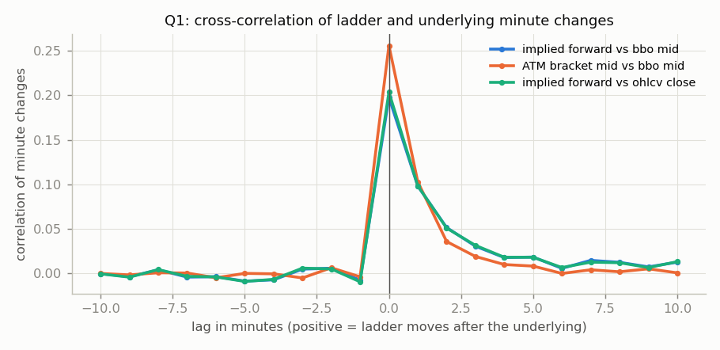
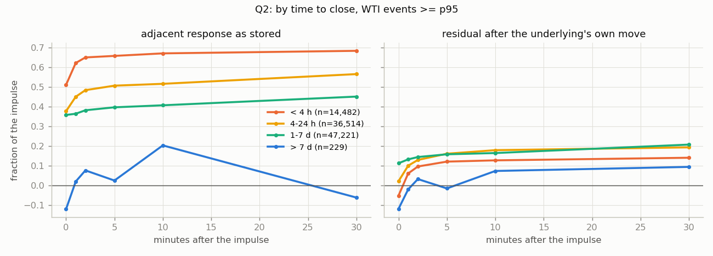
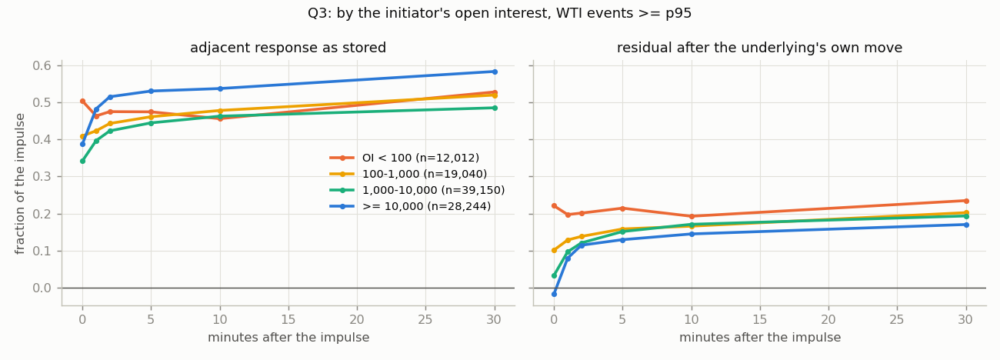

# FINDINGS_UNDERLYING — does the ladder lag its underlying?

Generated 2026-10-28 04:01 UTC by `python3 -m waves.run_underlying` / `python3 -m waves.report_underlying`. Brief: `NightKing/HANDOFF_underlying_lag.md`. Code: `waves/underlying.py`, `waves/run_underlying.py`. Results: `waves/results_underlying/`.

## Verdict

**Q1 — yes, the ladder lags the futures, by one to two minutes, and the lag is the quotes catching up.** On the daily WTI ladder the correlation of minute changes of the implied forward with the futures is 0.36 at lag 0, 0.17 one minute later, 0.07 two minutes later, 0.04 three, and nothing at a minute before. On 5-minute changes it is 0.59 at lag 0 and 0.16 one step later. About half of what the ladder does to a futures move it does inside the same minute and the rest over the next one to three; nothing leads.

**Q2 — the near-expiry late leg survives the underlying, and so does the same leg everywhere else.** In the last 4 hours, events >= p95 with a matched futures path (n = 14,482): the adjacent bracket's same-minute response is 0.51 and the futures' own same-minute move predicts 0.56 of it (residual -0.05 — the same-minute wave is entirely the underlying). Over the next thirty minutes the futures' move adds -0.02 but the neighbour adds +0.17, leaving a residual late leg of +0.19. The residual late leg is +0.17 at 4-24 h (n = 36,514) and +0.09 at 1-7 days (n = 47,221): it is not a near-expiry property, it is a property of the ladder, and it was hidden away from expiry only because the futures tend to give back part of the move while the quotes are still catching up.

**It is not time decay.** Split by whether settlement drift would push the neighbour with or against the impulse, the residual late leg is +0.11 where decay agrees (n = 49,015) and +0.16 where it opposes (n = 45,868). Decay would make the second negative; it is not.

**Q3 — the depth effect survives, and it is the strongest cell.** On brackets with 10,000 or more contracts of open interest the same-minute response (0.39) is fully the underlying (predicted 0.40, residual -0.02) and the residual late leg over thirty minutes is +0.19 (n = 28,244), against +0.01 on brackets under 100 contracts (n = 12,012), whose same-minute response over-shoots the underlying by +0.22 and then does nothing. Deep and within a day of close (n = 24,858): same-minute residual -0.04, residual late leg +0.20. This is a lag on brackets with size behind them, net of the futures.

**What it is.** Per unit of what the futures move is worth on the ladder's own curve, the adjacent bracket has moved 0.79 by the end of the impulse minute near expiry and 0.96 thirty minutes later; on deep brackets 0.45 then 0.78; pooled 0.54 then 0.77. The sensitivity is not understated (the slope converges on 1, it does not pass it): the response is incomplete at the minute and completes over the next five to thirty. That is a stale-quote lag — the ladder finishing a move the futures already made — visible at one-minute resolution, largest in relative terms on deep brackets, and of order a fifth of the impulse (an impulse >= p95 on these ladders is a few cents, so the leg is one to two cents per bracket). It is not a propagation wave and it is not information. Whether it can be touched is a question about resting size at the stale quote and about who else is lifting it, which is the live-book question, not a candle question. Nothing here is a trading rule; a catchability study needs its own protocol committed before any price is read.

**Resolution and the next step.** Q1 says the lag is one to three minutes, which candles do resolve, so this does not hit the sub-minute wall. The first follow-on is not a websocket collector; it is the executable version of this table — the neighbour's ask after the impulse against its bid thirty minutes later, with the resting size from `ladder/collect_books.py` — on the deep near-expiry WTI brackets, under a protocol committed first. A tick-level futures pull is cheap (section 4: about $2 per contract window for top-of-book, $18 for the whole 2026 span) and would sharpen the lag to seconds; it is warranted only after the executable version shows a net above zero.

## 0. Coverage and method

**Underlying paths.** WTI ladders: the Kalshi-named CL contract (rules text > `custom_strike.front_month_contract` > Kalshi's calendar convention, the V3 logic in `wti_arb/db_common.py`), from `data_cme/parquet/futures_intraday` — `bbo-1m` quote mid sampled at the minute boundary (the primary path) and `ohlcv-1m` close (a check), continuous 1-minute coverage 2026-01-07 to 2026-09-04 in nine contract windows. Hourly ETH ladders: Coinbase Exchange ETH-USD 1-minute candle close (keyless, free; `waves/pull_crypto.py`), 2024-06 to 2026-10. Alignment: a Databento bar or quote at the minute boundary T pairs with the Kalshi candle ending at T. A ladder counts as covered when the underlying is present on at least half of its grid minutes.

Ladders by series: covered / total, matched minutes, wave events inside coverage, and how the contract was named:

| series | ladders | covered | matched_minutes | events | beta_r2 |
|---|---|---|---|---|---|
| KXWTI | 696 | 67 | 169,335 | 65,311 | 0.03 |
| KXWTIMAX | 8 | 0 | 0.00 | 0 | 0.00 |
| KXWTIMAXM | 1 | 1 | 6586 | 253 | 0.00 |
| KXWTIMIN | 8 | 0 | 0.00 | 0 | 0.00 |
| KXWTIMINM | 3 | 2 | 23,022 | 1181 | 0.00 |
| KXWTIW | 191 | 24 | 153,051 | 20,445 | 0.00 |

| series | calendar | rules |
|---|---|---|
| KXWTI | 27 | 40 |
| KXWTIMAXM | 1 | 0 |
| KXWTIMINM | 2 | 0 |
| KXWTIW | 14 | 10 |

WTI wave events (>= p95) with a matched futures path, by time to close and the initiator's open interest — the cells every table below draws on:

| ttc | OI < 100 | 100-1,000 | 1,000-10,000 | >= 10,000 |
|---|---|---|---|---|
| < 4 h | 1 | 67 | 1251 | 8117 |
| 4-24 h | 195 | 1258 | 12,954 | 8509 |
| 1-7 d | 7169 | 11,232 | 13,988 | 4043 |
| > 7 d | 28 | 58 | 335 | 70 |

**Decomposition.** For every wave event (the per-bracket-normalised events of `FINDINGS_WAVES.md`) the neighbour's stored response at distance k and horizon h, resp = (mid[t+h] - mid[t-1]) / impulse, is split into the part the underlying explains and the rest:

    predicted = beta_neighbour x (U[t+h] - U[t-1]) / impulse,   residual = resp - predicted

beta is the bracket's sensitivity to a $1 move of the underlying. Two estimates: **shape** — read off the ladder's own curve at t-1 (the implied density at the strike, P(>X_{j-1}) - P(>X_{j+1}) over the strike gap; for a range bracket the density difference across its edges), which is instantaneous and unaffected by how sparsely the bracket is quoted; and **regression** — OLS of the bracket's minute changes on the underlying's over the ladder's life, which the carried-forward quotes bias toward zero (median R^2 0.02, median slope 0.7c/$ against 9.0c/$ from the shape). The shape beta carries the tables; the regression beta is shown once as the lower bound. The initiator's own move is decomposed the same way (`pred_d` = the share of the impulse that the same-minute underlying move accounts for).

**Q1** is a cross-correlation of minute changes of the ladder's implied forward (the strike where P(>X) = 0.5, linearly interpolated from quoted mids with spread <= 10c) with the underlying's minute changes at lags -10..+10, pooled over ladders by summing cross-products; positive lag = the ladder moves after the underlying. Also on the at-the-money bracket's mid and on 5-minute changes.

## 1. Q1 — does the ladder lag the futures?

**All WTI ladders**

| pair | n (lag 0) | L=-5 | L=-3 | L=-2 | L=-1 | L=+0 | L=+1 | L=+2 | L=+3 | L=+5 | L=+10 | peak lag | L=-3 x5min | L=-2 x5min | L=-1 x5min | L=+0 x5min | L=+1 x5min | L=+2 x5min | L=+3 x5min |
|---|---|---|---|---|---|---|---|---|---|---|---|---|---|---|---|---|---|---|---|
| implied forward vs bbo mid | 215,650 | -0.009 | 0.005 | 0.006 | -0.008 | 0.198 | 0.098 | 0.051 | 0.031 | 0.018 | 0.013 | 0.000 |  |  |  |  |  |  |  |
| implied forward vs ohlcv close | 213,448 | -0.009 | 0.006 | 0.005 | -0.009 | 0.204 | 0.098 | 0.051 | 0.031 | 0.018 | 0.013 | 0.000 |  |  |  |  |  |  |  |
| ATM bracket mid vs bbo mid | 203,896 | -0.000 | -0.005 | 0.006 | -0.004 | 0.256 | 0.103 | 0.036 | 0.019 | 0.008 | 0.001 | 0.000 |  |  |  |  |  |  |  |
| implied forward vs bbo mid, 5-minute changes | 42,926 |  |  |  |  |  |  |  |  |  |  |  | 0.021 | -0.013 | -0.009 | 0.384 | 0.128 | 0.063 | 0.051 |

**KXWTI**

| pair | n (lag 0) | L=-5 | L=-3 | L=-2 | L=-1 | L=+0 | L=+1 | L=+2 | L=+3 | L=+5 | L=+10 | peak lag | L=-3 x5min | L=-2 x5min | L=-1 x5min | L=+0 x5min | L=+1 x5min | L=+2 x5min | L=+3 x5min |
|---|---|---|---|---|---|---|---|---|---|---|---|---|---|---|---|---|---|---|---|
| implied forward vs bbo mid | 151,442 | -0.006 | -0.004 | 0.010 | -0.005 | 0.356 | 0.167 | 0.068 | 0.043 | 0.016 | 0.006 | 0.000 |  |  |  |  |  |  |  |
| implied forward vs ohlcv close | 150,052 | -0.007 | -0.003 | 0.010 | -0.006 | 0.358 | 0.167 | 0.067 | 0.043 | 0.016 | 0.005 | 0.000 |  |  |  |  |  |  |  |
| ATM bracket mid vs bbo mid | 142,166 | 0.000 | -0.006 | 0.008 | -0.005 | 0.334 | 0.133 | 0.046 | 0.024 | 0.010 | -0.000 | 0.000 |  |  |  |  |  |  |  |
| implied forward vs bbo mid, 5-minute changes | 30,183 |  |  |  |  |  |  |  |  |  |  |  | 0.009 | -0.020 | -0.014 | 0.591 | 0.164 | 0.048 | 0.049 |

**KXWTIW**

| pair | n (lag 0) | L=-5 | L=-3 | L=-2 | L=-1 | L=+0 | L=+1 | L=+2 | L=+3 | L=+5 | L=+10 | peak lag | L=-3 x5min | L=-2 x5min | L=-1 x5min | L=+0 x5min | L=+1 x5min | L=+2 x5min | L=+3 x5min |
|---|---|---|---|---|---|---|---|---|---|---|---|---|---|---|---|---|---|---|---|
| implied forward vs bbo mid | 50,600 | -0.022 | 0.018 | 0.002 | -0.017 | 0.045 | 0.036 | 0.059 | 0.029 | 0.037 | 0.033 | 2.000 |  |  |  |  |  |  |  |
| implied forward vs ohlcv close | 49,961 | -0.021 | 0.016 | 0.005 | -0.022 | 0.058 | 0.038 | 0.055 | 0.032 | 0.037 | 0.036 | 0.000 |  |  |  |  |  |  |  |
| ATM bracket mid vs bbo mid | 48,570 | -0.007 | -0.007 | 0.001 | -0.002 | 0.024 | 0.020 | 0.007 | -0.008 | 0.006 | 0.008 | 0.000 |  |  |  |  |  |  |  |
| implied forward vs bbo mid, 5-minute changes | 10,049 |  |  |  |  |  |  |  |  |  |  |  | 0.050 | -0.007 | -0.018 | 0.135 | 0.113 | 0.121 | 0.081 |

Reading: the correlation at lag 0 is 0.20 and at lag +1 (the ladder one minute after the futures) 0.10, at lag -1 (the ladder one minute before) -0.01, and nothing beyond ±2. The ladder tracks the futures within the candle; the one-minute tail is the carried-forward quotes catching up, visible but small. There is no lead.

## 2. Q2 — does the near-expiry late leg survive the underlying?

Adjacent neighbour (k = ±1 pooled), WTI events >= p95 with a matched path. `resp` is the stored neighbour response, `pred` the part the underlying's own move over the same window explains (shape beta), `resid` what is left. The last two columns are what each adds between the impulse minute and thirty minutes later — the quantity the brief asks about.

**By time to close (shape beta)**

| time_to_close | n_h0 | resp_h0 | pred_h0 | resid_h0 | resp_h30 | pred_h30 | resid_h30 | resp_added_0_30 | resid_added_0_30 |
|---|---|---|---|---|---|---|---|---|---|
| < 4 h | 14,482 | 0.512 | 0.563 | -0.051 | 0.685 | 0.543 | 0.142 | 0.173 | 0.192 |
| 4-24 h | 36,514 | 0.378 | 0.355 | 0.023 | 0.567 | 0.372 | 0.194 | 0.189 | 0.172 |
| 1-7 d | 47,221 | 0.359 | 0.245 | 0.114 | 0.452 | 0.244 | 0.209 | 0.093 | 0.095 |
| > 7 d | 229 | -0.119 | -0.001 | -0.118 | -0.060 | -0.156 | 0.095 | 0.059 | 0.213 |

**By time to close (regression beta — the lower bound on what the underlying explains)**

| time_to_close | n_h0 | resp_h0 | pred_h0 | resid_h0 | resp_h30 | pred_h30 | resid_h30 | resp_added_0_30 | resid_added_0_30 |
|---|---|---|---|---|---|---|---|---|---|
| < 4 h | 17,473 | 0.422 | 0.121 | 0.302 | 0.594 | 0.117 | 0.477 | 0.172 | 0.175 |
| 4-24 h | 41,046 | 0.346 | 0.117 | 0.229 | 0.525 | 0.117 | 0.408 | 0.178 | 0.179 |
| 1-7 d | 56,302 | 0.314 | 0.096 | 0.218 | 0.399 | 0.094 | 0.305 | 0.084 | 0.087 |
| > 7 d | 229 | -0.119 | -0.000 | -0.119 | -0.060 | 0.001 | -0.062 | 0.059 | 0.058 |

**Residual by distance** (same minute, and added over the next thirty):

| time_to_close | resid_h0 k=1 | resid_added k=1 | resid_h0 k=2 | resid_added k=2 | resid_h0 k=3 | resid_added k=3 | resid_h0 k=4 | resid_added k=4 | resid_h0 k=5 | resid_added k=5 |
|---|---|---|---|---|---|---|---|---|---|---|
| < 4 h | -0.051 | 0.192 | -0.059 | 0.165 | -0.056 | 0.136 | -0.048 | 0.112 | -0.036 | 0.113 |
| 4-24 h | 0.023 | 0.172 | -0.010 | 0.170 | -0.018 | 0.159 | -0.028 | 0.142 | -0.030 | 0.124 |
| 1-7 d | 0.114 | 0.095 | 0.072 | 0.109 | 0.048 | 0.095 | 0.026 | 0.117 | 0.015 | 0.097 |
| > 7 d | -0.118 | 0.213 | -0.225 | 0.328 | -0.052 | -0.102 | -0.357 | 0.238 | 0.118 | -0.039 |

**Effective sensitivity** — the slope of the neighbour's response on the futures-implied response (1 = the ladder has moved exactly what its own shape says the futures move is worth):

| time_to_close | h0 | n | h1 | h2 | h5 | h10 | h30 |
|---|---|---|---|---|---|---|---|
| < 4 h | 0.79 | 14,482 | 0.89 | 0.91 | 0.94 | 0.96 | 0.96 |
| 4-24 h | 0.62 | 36,514 | 0.74 | 0.77 | 0.79 | 0.81 | 0.83 |
| 1-7 d | 0.38 | 47,217 | 0.39 | 0.40 | 0.43 | 0.49 | 0.59 |
| > 7 d | 0.08 | 229 | 0.08 | 0.08 | -0.09 | -0.15 | -0.02 |

| open_interest | h0 | n | h1 | h2 | h5 | h10 | h30 |
|---|---|---|---|---|---|---|---|
| OI < 100 | 0.88 | 12,012 | 0.86 | 0.84 | 0.83 | 0.82 | 0.83 |
| 100-1,000 | 0.77 | 19,040 | 0.75 | 0.75 | 0.75 | 0.73 | 0.75 |
| 1,000-10,000 | 0.53 | 39,148 | 0.60 | 0.64 | 0.68 | 0.71 | 0.77 |
| >= 10,000 | 0.45 | 28,242 | 0.56 | 0.58 | 0.63 | 0.69 | 0.78 |

**Is the late leg time decay?** As a ladder approaches settlement, P(>X) drifts toward 1 for strikes below the price and toward 0 for strikes above it, whatever the futures do. That drift has the impulse's sign for a neighbour below the price after an up-move (or above after a down-move) and the opposite sign otherwise. If the residual late leg were decay it would be positive in the first group and negative in the second:

| time_to_close | resid_added (decay agrees) | n (agrees) | resid_added (decay opposes) | n (opposes) |
|---|---|---|---|---|
| < 4 h | 0.221 | 6554 | 0.130 | 5617 |
| 4-24 h | 0.143 | 18,463 | 0.209 | 17,105 |
| 1-7 d | 0.058 | 23,885 | 0.132 | 23,033 |
| > 7 d | 0.082 | 113 | 0.367 | 113 |

| open_interest | resid_added (decay agrees) | n (agrees) | resid_added (decay opposes) | n (opposes) |
|---|---|---|---|---|
| OI < 100 | -0.092 | 5864 | 0.119 | 6048 |
| 100-1,000 | 0.041 | 9597 | 0.165 | 9299 |
| 1,000-10,000 | 0.159 | 19,558 | 0.166 | 18,583 |
| >= 10,000 | 0.181 | 13,996 | 0.171 | 11,938 |

**The initiator itself**: how much of the impulse the same-minute underlying move accounts for, and how often the underlying moved at all in the impulse minute:

| time_to_close | n | initiator_share_explained | share_events_with_underlying_move |
|---|---|---|---|
| < 4 h | 7610 | 0.640 | 0.989 |
| 4-24 h | 19,253 | 0.360 | 0.936 |
| 1-7 d | 25,319 | 0.258 | 0.813 |
| > 7 d | 197 | 0.043 | 0.402 |

## 3. Q3 — does the depth effect survive?

**By the initiator's open interest** (WTI, >= p95, k = ±1, shape beta):

| open_interest | n_h0 | resp_h0 | pred_h0 | resid_h0 | resp_h30 | pred_h30 | resid_h30 | resp_added_0_30 | resid_added_0_30 |
|---|---|---|---|---|---|---|---|---|---|
| OI < 100 | 12,012 | 0.503 | 0.282 | 0.221 | 0.528 | 0.292 | 0.235 | 0.024 | 0.014 |
| 100-1,000 | 19,040 | 0.409 | 0.307 | 0.102 | 0.519 | 0.317 | 0.203 | 0.110 | 0.101 |
| 1,000-10,000 | 39,150 | 0.342 | 0.308 | 0.033 | 0.485 | 0.291 | 0.194 | 0.143 | 0.160 |
| >= 10,000 | 28,244 | 0.387 | 0.404 | -0.017 | 0.583 | 0.412 | 0.171 | 0.196 | 0.187 |

**Open interest × time to close** — the cell that matters, with its counts:

| open_interest | time_to_close | n | resp_h0 | resid_h0 | resp_h30 | resid_h30 | resp_added | resid_added |
|---|---|---|---|---|---|---|---|---|
| OI < 100 | < 4 h | 0 | - | - | - | - | - | - |
| OI < 100 | 4-24 h | 266 | 0.486 | 0.422 | 0.195 | 0.245 | -0.291 | -0.177 |
| OI < 100 | 1-7 d | 11,738 | 0.504 | 0.216 | 0.532 | 0.233 | 0.029 | 0.017 |
| OI < 100 | > 7 d | 8 | 0.750 | 0.755 | 3.354 | 2.951 | 2.604 | 2.196 |
| 100-1,000 | < 4 h | 70 | 0.231 | 0.088 | 0.172 | -0.073 | -0.060 | -0.161 |
| 100-1,000 | 4-24 h | 2042 | 0.330 | 0.204 | 0.428 | 0.322 | 0.099 | 0.118 |
| 100-1,000 | 1-7 d | 16,912 | 0.419 | 0.089 | 0.532 | 0.190 | 0.112 | 0.101 |
| 100-1,000 | > 7 d | 16 | 0.406 | 0.423 | -0.178 | -0.282 | -0.584 | -0.705 |
| 1,000-10,000 | < 4 h | 2079 | 0.621 | -0.013 | 0.809 | 0.073 | 0.188 | 0.086 |
| 1,000-10,000 | 4-24 h | 21,681 | 0.387 | 0.022 | 0.541 | 0.196 | 0.155 | 0.175 |
| 1,000-10,000 | 1-7 d | 15,227 | 0.246 | 0.059 | 0.373 | 0.209 | 0.127 | 0.150 |
| 1,000-10,000 | > 7 d | 163 | -0.248 | -0.227 | -0.225 | -0.154 | 0.023 | 0.073 |
| >= 10,000 | < 4 h | 12,333 | 0.495 | -0.058 | 0.665 | 0.156 | 0.170 | 0.214 |
| >= 10,000 | 4-24 h | 12,525 | 0.369 | -0.014 | 0.638 | 0.171 | 0.269 | 0.184 |
| >= 10,000 | 1-7 d | 3344 | 0.061 | 0.125 | 0.123 | 0.210 | 0.061 | 0.085 |
| >= 10,000 | > 7 d | 42 | 0.015 | -0.065 | -0.031 | 0.670 | -0.046 | 0.735 |

**By the neighbour's spread** (WTI, >= p95, k = ±1):

| initiator_spread | n_h0 | resp_h0 | pred_h0 | resid_h0 | resp_h30 | pred_h30 | resid_h30 | resp_added_0_30 | resid_added_0_30 |
|---|---|---|---|---|---|---|---|---|---|
| <= 2c | 57,580 | 0.377 | 0.320 | 0.057 | 0.514 | 0.321 | 0.193 | 0.137 | 0.136 |
| 3-5c | 31,546 | 0.447 | 0.415 | 0.032 | 0.575 | 0.396 | 0.179 | 0.128 | 0.146 |
| 6-10c | 9320 | 0.249 | 0.127 | 0.122 | 0.407 | 0.152 | 0.256 | 0.159 | 0.134 |

**By event size**:

| band | n_h0 | resp_h0 | pred_h0 | resid_h0 | resp_h30 | pred_h30 | resid_h30 | resp_added_0_30 | resid_added_0_30 |
|---|---|---|---|---|---|---|---|---|---|
| p90-95 | 103,420 | 0.356 | 0.329 | 0.026 | 0.493 | 0.323 | 0.170 | 0.137 | 0.143 |
| p95-99 | 78,832 | 0.378 | 0.335 | 0.043 | 0.515 | 0.328 | 0.187 | 0.137 | 0.144 |
| p99-99.9 | 15,688 | 0.419 | 0.340 | 0.079 | 0.569 | 0.360 | 0.209 | 0.149 | 0.129 |
| >= p99.9 | 3926 | 0.448 | 0.242 | 0.206 | 0.528 | 0.242 | 0.286 | 0.080 | 0.080 |

## 4. What a finer look would cost

| what | schema | cost |
|---|---|---|
| CL minute coverage extension 2026-09-05..10-27, CLX6+CLZ6 | ohlcv-1m | 0.32 |
| CL minute coverage extension 2026-09-05..10-27, CLX6+CLZ6 | bbo-1m | 0.13 |
| CL tick-level, one contract window (CLQ6, 2026-06-24..07-10, 15 days) | trades | 1.21 |
| CL tick-level, one contract window (CLQ6, 2026-06-24..07-10, 15 days) | mbp-1 | 1.82 |
| CL tick-level, one contract window (CLQ6, 2026-06-24..07-10, 15 days) | tbbo | 2.02 |
| CL tick-level, one US session (CLQ6, 2026-07-01 13:00-21:00 UTC) | trades | 0.05 |
| CL tick-level, one US session (CLQ6, 2026-07-01 13:00-21:00 UTC) | mbp-1 | 0.06 |
| GC minute bars 2026-03-01..09-10 (GCM6,GCQ6,GCZ6) | ohlcv-1m | 0.97 |
| SI minute bars 2026-03-01..09-10 (SIK6,SIN6,SIU6) | ohlcv-1m | 0.81 |
| NG minute bars 2026-03-01..09-10 (NGK6,NGM6,NGN6,NGQ6,NGU6) | ohlcv-1m | - |
| HG minute bars 2026-03-01..09-10 (HGK6,HGN6,HGU6) | ohlcv-1m | 0.83 |

Prices are Databento `metadata.get_cost` quotes made with `execute=False`; nothing was bought.
