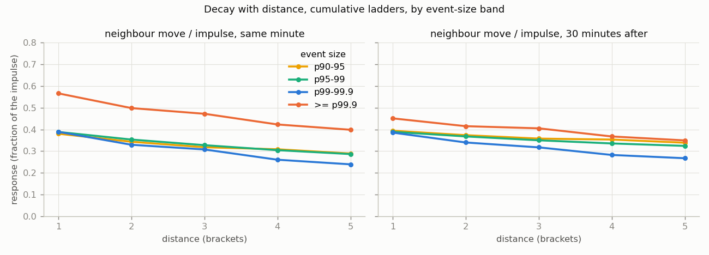
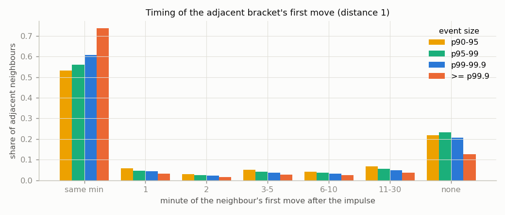
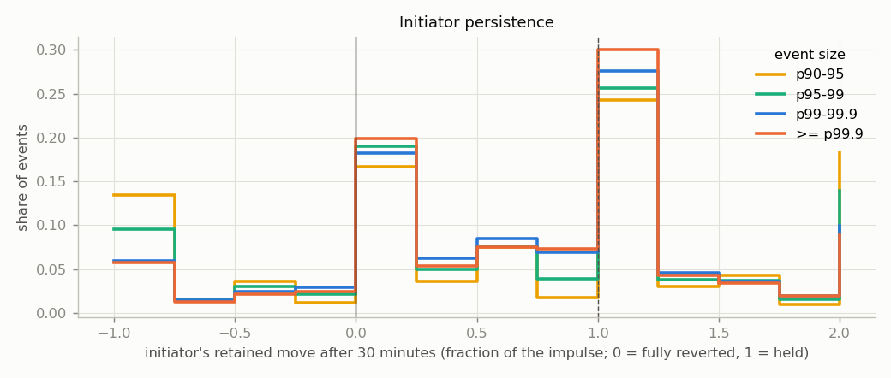
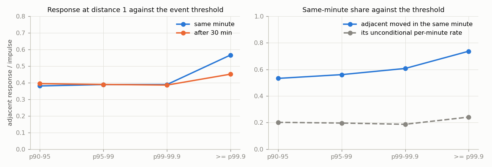

# FINDINGS_WAVES — do propagation waves exist? A descriptive census

Generated 2026-10-23 01:12 UTC by `python3 -m waves.run` / `python3 -m waves.report`. Brief: `NightKing/HANDOFF_waves.md`. Code: `waves/`. Results: `waves/results/` (per-ladder parts, `summary.parquet`, `events.parquet`), plots `waves/plots/`.

Ladders present in both stores (markets closing after 2026-09-01, re-pulled in full for the forward extension) are counted once, from the expanded store.

Stores: commodity (2125 ladders), expanded (32896 ladders). Ladders processed 35,021 (30,767 with enough changes to define events, 4,254 skipped with fewer than 50 non-zero mid changes), 159,032 ladder-days, 51,658,688 non-zero minute-to-minute mid changes on tight two-sided brackets. No model, no trade, no friction: every number is a description of what the ladder did.

## Verdict

**Two populations, one answer each.** Ladders with a traded underlying (commodities, financials, sports, crypto: 14,691 cumulative ladders) carry a wave; ladders without one (politics, economics, elections, entertainment, weather, companies, science, health, social, world: 16,076 ladders) barely carry anything. The brief's hypothesis was that waves are largest where no underlying forces the ladder to stay coherent. The census says the opposite.

**With an underlying: a wave exists; it is wide, shallow, and over inside the impulse minute — except in the last day of a ladder's life, where a slow second leg follows.** When a bracket makes a move in the top 1% of its own distribution, the adjacent bracket moves in the same minute 77% of the time (its unconditional chance of moving in any minute is 27%), by 0.52 of the impulse; five strikes away it moves in the same minute 61% of the time, by 0.31. The next thirty minutes add only -0.01 of the impulse at distance 1; the share that moves later than the impulse minute but within thirty (18%) is what the neighbour's own activity rate predicts (96% within thirty unconditionally), and 5% do not move at all.

**Without an underlying: there is no wave to speak of.** At the same top-1% threshold the adjacent bracket moves in the same minute 31% of the time against a baseline of 3%, by 0.14 of the impulse (five strikes away 0.01); after thirty minutes it has moved 0.16 of the impulse, 49% have not moved at all, and the share moving later than the impulse minute (20%) is below what the neighbour does anyway (42% within thirty unconditionally). By category the same-minute response is: Climate and Weather 0.13 (n 140,441), Companies 0.13 (n 74,585), Economics 0.11 (n 597,521), Elections 0.20 (n 80,600), Entertainment 0.15 (n 352,491), Health 0.02 (n 5,768), Politics 0.13 (n 128,567), Science and Technology 0.18 (n 136,868), Social 0.03 (n 5,631). These brackets are quoted one at a time: a re-quote of one threshold is rarely accompanied by a re-quote of its neighbours, and when the neighbours do move later it is their ordinary, sparse activity. (Among the ladders with an underlying, the hourly crypto ladder is the odd one: 0.18 same minute, 0.32 after thirty — the near-expiry effect below, since those ladders are always within an hour of close.)

**Time to close is the conditioning that matters.** For events (>= p95) in the last 4 hours before close the adjacent bracket moves 0.74 of the impulse in the same minute and 0.84 after thirty (+0.10 added, n = 569,956); at 4-24 hours 0.56 then 0.64 (+0.08, n = 960,768); at 1-7 days the thirty-minute response is below the same-minute one (-0.05, n = 1,009,812) and beyond 7 days the wave barely exists (0.26 same minute, n = 428,496). The late leg near expiry travels with distance (section 6): it is a ladder-wide drift, not a nearest-neighbour relay. The initiator holds its move fully in the last day (retained 1.00 after thirty minutes) and only 0.60 beyond a week. Candles cannot tell whether that late leg is propagation (neighbours catching up to the initiator) or the underlying continuing to move with every bracket following it; both read the same on a minute grid.

**Depth works the same way.** Split by the initiating bracket's open interest, the same-minute response falls from 0.59 (under 100 contracts) to 0.45 (10,000 or more) while the thirty-minute response rises from 0.51 to 0.57: thin brackets are re-quoted together at once, deep ones follow over the half hour (+0.12 added). The slow part of the wave lives where the size is — the opposite of the stale-tail picture, and the one place where a lag and depth coincide. Hour of day adds a smaller version of the same thing (US morning: +0.04 added; overnight: -0.03).

**The threshold sweep (ladders with an underlying): the 'unusual move' framing adds little.** From the 90th to the 99.9th percentile of a bracket's own changes the same-minute adjacent response rises from 0.50 to 0.65 of the impulse and the same-minute share from 67% to 81%; the thirty-minute response is flat (0.53 to 0.51), and at the top band the neighbours give back 0.14 of the impulse over the half hour. Bigger events are followed a little more often and a little more fully in the same minute, and no more afterwards. There is no threshold above which a lagged response appears; the lag is a function of time to expiry, not of event size. Every band has tens of thousands of events or more, so none of this is thin.

**Initiators mostly hold, and trade-driven ones hold best (ladders with an underlying).** After thirty minutes the initiating bracket retains a mean 0.63 of its move at the top band; 48% retain at least half, 24% have fully reverted. Moves made by a trade in the minute retain ~1.0 of the move with 18% reverting; pure quote moves retain 0.71 with 27% reverting. The spike trap is real for quote-driven moves and a minority overall.

**Decay with distance is slow and nearly linear**: each extra strike removes about a tenth of the response (step ratios 0.85-0.92 at every band), so five strikes away still carries 59% of the adjacent response. The wave is a parallel shift that fades gently, not a nearest-neighbour cliff.

**Resolution and what to do next.** Away from expiry, everything the wave does it does inside the candle, and candles cannot say whether that is one second or fifty-nine; a wave that is catchable at all there is sub-minute and only a websocket book feed can see it. Near expiry the late leg is visible at minute resolution and is the thing a follow-on should test first, on the daily commodity ladders where it is largest (KXBRENTD, KXGOLDD, KXWTI, KXNATGASD) — see `NEXT_STUDY.md`. The websocket collector is warranted only if that near-expiry leg survives a check against the underlying's own path, which is a cheaper question.

## 0. Definitions and data construction

- Movement is measured on mids of the carried-forward minute grid (ladder.store), only where the bracket is two-sided with spread <= 10c on both minutes (so the mid means something; a bid 19 / ask 99 book has no mid). The store is sparse by design (a candle exists only when the top of book changed, verified in `ladder/FINDINGS_LADDER_DYNAMICS.md` §0), so a bracket's minute-to-minute change is non-zero exactly on the minutes it printed.
- **Per-bracket normalisation.** A bracket's event thresholds are the 90th / 95th / 99th / 99.9th percentiles of the absolute size of its own non-zero changes. Mids move in half-cent steps, so the percentile values are discrete and ties are common: 'at or above the 90th percentile value' takes about 17% of changes rather than 10%, and the bands below are labelled by the percentile cleared, not by an exact share. A bracket with fewer than 50 non-zero changes borrows its ladder's pooled distribution (flagged; 3.0% of sampled events); a ladder with fewer than 50 changes in total is skipped.
- **Event** = a minute where a bracket's change clears its 90th-percentile threshold; its band is the highest percentile it clears. Events in the 90-95 band are stored 1-in-4 with weight 4 (every count and mean below is weighted); every event above the 95th is stored.
- **Response** of a neighbour at distance k, horizon h = (its mid at t+h minus its mid at t-1) divided by the initiator's change, signed; on a P(>X) ladder a parallel shift gives the same sign at every distance. Both sides (+k and -k) are pooled. h = 0 is the impulse minute. **First move** = the first minute in 0..30 at which the neighbour's mid differs from its value at t-1 (any half-cent); 'none' = no change within 30 minutes. **Baseline** = the neighbour's own unconditional change probability per valid minute over the ladder's life, and 1-(1-r)^(h+1) for 'within h'.
- **Persistence** = the initiator's retained move after h minutes as a fraction of its change: >= 0.5 persists, (0, 0.5) partial, <= 0 reverted.
- Range ladders (brackets '$77 to 77.99') have no common sign convention for neighbours, so they are reported on timing and absolute response only (section 7). Everything else is cumulative ladders.

## 1. Event frequency

| threshold | events | per_ladder_day | per_bracket_day | share_of_changes |
|---|---|---|---|---|
| ≥ p90 | 8,612,289 | 54.154 | 5.015 | 0.167 |
| ≥ p95 | 4,321,867 | 27.176 | 2.516 | 0.084 |
| ≥ p99 | 913,627 | 5.745 | 0.532 | 0.018 |
| ≥ p99.9 | 269,996 | 1.698 | 0.157 | 0.005 |

By store and category:

| tag | category | ladders | ladder_days | changes | e95 | e99 | e999 | p95_per_ladder_day | p99_per_ladder_day | p99.9_per_ladder_day |
|---|---|---|---|---|---|---|---|---|---|---|
| expanded | Climate and Weather | 12,799 | 34885.16 | 17,646,358 | 1,208,602 | 261,296 | 81,429 | 34.65 | 7.49 | 2.33 |
| commodity | Commodities | 1246 | 4501.08 | 12,534,840 | 1,003,093 | 223,513 | 64,663 | 222.86 | 49.66 | 14.37 |
| expanded | Commodities | 2582 | 2372.86 | 5,399,219 | 380,680 | 77,531 | 26,816 | 160.43 | 32.67 | 11.30 |
| expanded | Financials | 3319 | 2690.70 | 4,283,019 | 306,032 | 68,788 | 26,827 | 113.74 | 25.57 | 9.97 |
| expanded | Entertainment | 595 | 17016.17 | 2,404,162 | 250,967 | 46,051 | 9575 | 14.75 | 2.71 | 0.56 |
| expanded | Crypto | 5073 | 1277.69 | 1,983,406 | 143,200 | 31,015 | 12,600 | 112.08 | 24.27 | 9.86 |
| expanded | Economics | 575 | 19320.35 | 1,576,789 | 292,634 | 72,904 | 13,667 | 15.15 | 3.77 | 0.71 |
| commodity | Economics | 512 | 10998.02 | 1,510,201 | 213,560 | 25,486 | 5962 | 19.42 | 2.32 | 0.54 |
| expanded | Sports | 2451 | 2624.51 | 1,216,981 | 94,176 | 23,187 | 14,565 | 35.88 | 8.83 | 5.55 |
| expanded | Politics | 538 | 18071.83 | 1,177,260 | 152,467 | 20,279 | 4396 | 8.44 | 1.12 | 0.24 |
| expanded | Science and Technology | 205 | 9349.08 | 902,321 | 111,211 | 19,357 | 3312 | 11.90 | 2.07 | 0.35 |
| expanded | Elections | 800 | 25673.49 | 421,304 | 76,736 | 26,548 | 3667 | 2.99 | 1.03 | 0.14 |
| expanded | Companies | 40 | 5750.01 | 301,804 | 44,451 | 9609 | 1618 | 7.73 | 1.67 | 0.28 |
| commodity | Financials | 20 | 2572.09 | 252,590 | 31,817 | 7161 | 804 | 12.37 | 2.78 | 0.31 |
| expanded | Health | 1 | 661.67 | 16,300 | 4628 | 228 | 27 | 6.99 | 0.34 | 0.04 |
| expanded | World | 1 | 467.63 | 15,603 | 1058 | 291 | 29 | 2.26 | 0.62 | 0.06 |
| commodity | Companies | 6 | 464.36 | 9449 | 966 | 194 | 20 | 2.08 | 0.42 | 0.04 |
| expanded | Social | 1 | 286.43 | 6542 | 5557 | 182 | 14 | 19.40 | 0.64 | 0.05 |
| commodity | Transportation | 3 | 49.79 | 540 | 32 | 7 | 5 | 0.64 | 0.14 | 0.10 |

Top 25 series by changes:

| series | ladders | ladder_days | changes | e99 | p99_per_ladder_day |
|---|---|---|---|---|---|
| KXINXU | 2871 | 1175.88 | 3,308,189 | 48,978 | 41.65 |
| KXWTI | 522 | 1053.33 | 3,227,913 | 48,033 | 45.60 |
| KXNATGASD | 104 | 202.39 | 2,002,613 | 31,564 | 155.96 |
| KXETH | 5057 | 836.20 | 1,802,585 | 27,952 | 33.43 |
| KXSILVERD | 106 | 208.51 | 1,568,145 | 24,665 | 118.29 |
| KXGOLDD | 108 | 211.50 | 1,493,835 | 23,108 | 109.26 |
| KXRT | 95 | 3438.27 | 1,345,826 | 18,937 | 5.51 |
| KXBRENTD | 109 | 213.41 | 1,264,592 | 18,137 | 84.99 |
| KXMLBF5TOTAL | 2451 | 2624.51 | 1,216,981 | 23,187 | 8.83 |
| KXHIGHNY | 648 | 1032.21 | 1,056,102 | 14,708 | 14.25 |
| KXHIGHLAX | 643 | 1104.24 | 1,036,011 | 14,383 | 13.03 |
| KXHIGHCHI | 648 | 1057.07 | 1,021,620 | 14,365 | 13.59 |
| KXHIGHAUS | 648 | 1059.19 | 1,011,051 | 14,464 | 13.66 |
| KXHIGHDEN | 648 | 1086.20 | 969,323 | 14,074 | 12.96 |
| KXCOPPERD | 106 | 207.65 | 952,071 | 16,402 | 78.99 |
| KXHIGHMIA | 648 | 1032.20 | 865,391 | 12,308 | 11.92 |
| KXGOLDW | 31 | 199.53 | 855,977 | 14,187 | 71.10 |
| KXHIGHPHIL | 648 | 1032.20 | 853,544 | 12,482 | 12.09 |
| KXINX | 442 | 1020.98 | 852,536 | 18,050 | 17.68 |
| KXSILVERH | 1227 | 95.93 | 797,540 | 10,478 | 109.23 |
| KXGOLDMON | 9 | 230.74 | 713,676 | 11,938 | 51.74 |
| KXCOPPERW | 25 | 164.42 | 710,647 | 15,464 | 94.05 |
| KXWTIH | 1169 | 84.44 | 705,082 | 9247 | 109.50 |
| KXSILVERMON | 8 | 213.53 | 660,013 | 10,161 | 47.59 |
| KXFED | 21 | 6621.82 | 582,477 | 26,138 | 3.95 |

## 2. Response amplitude by distance (cumulative ladders)

Mean neighbour move as a fraction of the impulse, pooled over both sides. n = weighted events with a valid neighbour at that distance.

**h = 0 (same minute)**

| band | k=1 | n(k=1) | k=2 | k=3 | k=4 | k=5 | n(k=5) |
|---|---|---|---|---|---|---|---|
| p90-95 | 0.380 | 4,493,444 | 0.343 | 0.318 | 0.309 | 0.289 | 2,829,464 |
| p95-99 | 0.389 | 3,562,626 | 0.353 | 0.328 | 0.305 | 0.287 | 2,168,660 |
| p99-99.9 | 0.389 | 663,606 | 0.329 | 0.308 | 0.260 | 0.239 | 423,288 |
| >= p99.9 | 0.566 | 250,742 | 0.499 | 0.472 | 0.423 | 0.399 | 154,364 |

**h = 5 minutes after**

| band | k=1 | n(k=1) | k=2 | k=3 | k=4 | k=5 | n(k=5) |
|---|---|---|---|---|---|---|---|
| p90-95 | 0.383 | 4,493,444 | 0.356 | 0.335 | 0.326 | 0.313 | 2,829,464 |
| p95-99 | 0.383 | 3,562,626 | 0.356 | 0.332 | 0.314 | 0.300 | 2,168,660 |
| p99-99.9 | 0.383 | 663,606 | 0.334 | 0.299 | 0.269 | 0.252 | 423,288 |
| >= p99.9 | 0.498 | 250,742 | 0.452 | 0.429 | 0.386 | 0.365 | 154,364 |

**h = 30 minutes after**

| band | k=1 | n(k=1) | k=2 | k=3 | k=4 | k=5 | n(k=5) |
|---|---|---|---|---|---|---|---|
| p90-95 | 0.394 | 4,493,444 | 0.374 | 0.358 | 0.354 | 0.339 | 2,829,464 |
| p95-99 | 0.389 | 3,562,626 | 0.368 | 0.350 | 0.336 | 0.324 | 2,168,660 |
| p99-99.9 | 0.386 | 663,606 | 0.340 | 0.317 | 0.282 | 0.267 | 423,288 |
| >= p99.9 | 0.451 | 250,742 | 0.415 | 0.405 | 0.368 | 0.350 | 154,364 |

**Added after the same minute (h=30 minus h=0)** — what a minute-resolution observer could still see coming:

| band | k=1 | k=2 | k=3 | k=4 | k=5 |
|---|---|---|---|---|---|
| p90-95 | 0.014 | 0.030 | 0.040 | 0.045 | 0.050 |
| p95-99 | 0.001 | 0.014 | 0.022 | 0.031 | 0.038 |
| p99-99.9 | -0.003 | 0.010 | 0.010 | 0.022 | 0.028 |
| >= p99.9 | -0.115 | -0.083 | -0.067 | -0.055 | -0.049 |

**Direction agreement at h=30** (share of neighbours whose net move has the impulse's sign; 0.5 = coin flip):

| band | k=1 | k=2 | k=3 | k=4 | k=5 |
|---|---|---|---|---|---|
| p90-95 | 0.413 | 0.401 | 0.393 | 0.394 | 0.395 |
| p95-99 | 0.425 | 0.418 | 0.413 | 0.409 | 0.411 |
| p99-99.9 | 0.479 | 0.457 | 0.446 | 0.424 | 0.428 |
| >= p99.9 | 0.538 | 0.513 | 0.510 | 0.481 | 0.466 |

## 3. Response timing by distance

| band | k | n | same_minute | within_5 | within_30 | none_30 | baseline_same | baseline_5 | baseline_30 | median_min_if_moved |
|---|---|---|---|---|---|---|---|---|---|---|
| p90-95 | 1 | 4,502,064 | 0.532 | 0.672 | 0.782 | 0.218 | 0.202 | 0.536 | 0.790 | 0.000 |
| p90-95 | 2 | 4,075,384 | 0.502 | 0.650 | 0.767 | 0.233 | 0.206 | 0.548 | 0.797 | 0.000 |
| p90-95 | 3 | 3,624,664 | 0.480 | 0.635 | 0.758 | 0.242 | 0.210 | 0.561 | 0.808 | 0.000 |
| p90-95 | 5 | 2,845,308 | 0.462 | 0.637 | 0.775 | 0.225 | 0.218 | 0.592 | 0.844 | 0.000 |
| p95-99 | 1 | 3,572,765 | 0.560 | 0.674 | 0.767 | 0.233 | 0.197 | 0.517 | 0.759 | 0.000 |
| p95-99 | 2 | 3,179,041 | 0.540 | 0.665 | 0.766 | 0.234 | 0.204 | 0.539 | 0.782 | 0.000 |
| p95-99 | 3 | 2,813,005 | 0.522 | 0.655 | 0.763 | 0.237 | 0.209 | 0.554 | 0.796 | 0.000 |
| p95-99 | 5 | 2,186,007 | 0.503 | 0.655 | 0.775 | 0.225 | 0.218 | 0.586 | 0.834 | 0.000 |
| p99-99.9 | 1 | 666,244 | 0.607 | 0.711 | 0.793 | 0.207 | 0.187 | 0.518 | 0.767 | 0.000 |
| p99-99.9 | 2 | 604,177 | 0.577 | 0.691 | 0.782 | 0.218 | 0.190 | 0.531 | 0.792 | 0.000 |
| p99-99.9 | 3 | 540,234 | 0.554 | 0.673 | 0.768 | 0.232 | 0.191 | 0.535 | 0.789 | 0.000 |
| p99-99.9 | 5 | 427,319 | 0.515 | 0.650 | 0.765 | 0.235 | 0.194 | 0.553 | 0.811 | 0.000 |
| >= p99.9 | 1 | 254,207 | 0.736 | 0.812 | 0.874 | 0.126 | 0.242 | 0.539 | 0.799 | 0.000 |
| >= p99.9 | 2 | 227,006 | 0.693 | 0.779 | 0.850 | 0.150 | 0.244 | 0.549 | 0.805 | 0.000 |
| >= p99.9 | 3 | 194,299 | 0.677 | 0.776 | 0.857 | 0.143 | 0.250 | 0.572 | 0.831 | 0.000 |
| >= p99.9 | 5 | 157,518 | 0.613 | 0.723 | 0.810 | 0.190 | 0.242 | 0.570 | 0.817 | 0.000 |

'same_minute' is the ceiling on what one-minute candles can resolve. 'baseline_same' is what the neighbour does in any minute; the excess is the wave. 'none_30' never moved within thirty minutes.

## 4. Decay with distance

Response at distance k relative to distance 1, and the step ratio between successive distances (a constant step ratio is exponential decay; a ratio that rises toward 1 is slower than exponential).

| band | h0 k1/k1 | h0 k2/k1 | h0 k3/k1 | h0 k4/k1 | h0 k5/k1 | h30 k1/k1 | h30 k2/k1 | h30 k3/k1 | h30 k4/k1 | h30 k5/k1 | h0 step 1->2 | h0 step 2->3 | h0 step 3->4 | h0 step 4->5 |
|---|---|---|---|---|---|---|---|---|---|---|---|---|---|---|
| p90-95 | 1.000 | 0.903 | 0.836 | 0.811 | 0.760 | 1.000 | 0.948 | 0.908 | 0.897 | 0.859 | 0.903 | 0.926 | 0.970 | 0.936 |
| p95-99 | 1.000 | 0.910 | 0.843 | 0.784 | 0.737 | 1.000 | 0.945 | 0.899 | 0.862 | 0.833 | 0.910 | 0.927 | 0.930 | 0.941 |
| p99-99.9 | 1.000 | 0.847 | 0.791 | 0.670 | 0.615 | 1.000 | 0.882 | 0.823 | 0.733 | 0.693 | 0.847 | 0.934 | 0.846 | 0.919 |
| >= p99.9 | 1.000 | 0.880 | 0.834 | 0.747 | 0.704 | 1.000 | 0.920 | 0.898 | 0.815 | 0.775 | 0.880 | 0.947 | 0.896 | 0.942 |

## 5. Initiator persistence (the trap check)

| band | n | ret_5 | ret_30 | persist_30 | partial_30 | revert_30 | overshoot_30 | trade_driven |
|---|---|---|---|---|---|---|---|---|
| p90-95 | 2,563,352 | 0.754 | 0.738 | 0.576 | 0.040 | 0.344 | 0.200 | 0.112 |
| p95-99 | 2,088,967 | 0.717 | 0.724 | 0.570 | 0.064 | 0.317 | 0.164 | 0.153 |
| p99-99.9 | 401,951 | 0.764 | 0.745 | 0.602 | 0.097 | 0.259 | 0.137 | 0.252 |
| >= p99.9 | 134,978 | 0.716 | 0.670 | 0.536 | 0.077 | 0.235 | 0.112 | 0.331 |

By whether the impulse minute carried a trade on the initiating bracket:

| band | initiator | n | ret_5 | ret_30 | persist_30 | partial_30 | revert_30 | overshoot_30 | trade_driven |
|---|---|---|---|---|---|---|---|---|---|
| p95-99 | trade in the minute | 275,520 | 0.997 | 1.057 | 0.567 | 0.056 | 0.197 | 0.254 | 1.000 |
| p95-99 | no trade (quote move) | 1,813,447 | 0.668 | 0.673 | 0.570 | 0.065 | 0.339 | 0.147 | 0.000 |
| p99-99.9 | trade in the minute | 93,894 | 0.991 | 1.005 | 0.649 | 0.087 | 0.150 | 0.216 | 1.000 |
| p99-99.9 | no trade (quote move) | 308,057 | 0.690 | 0.665 | 0.586 | 0.100 | 0.295 | 0.111 | 0.000 |
| >= p99.9 | trade in the minute | 36,951 | 0.960 | 0.936 | 0.516 | 0.078 | 0.107 | 0.144 | 1.000 |
| >= p99.9 | no trade (quote move) | 98,027 | 0.604 | 0.569 | 0.546 | 0.077 | 0.298 | 0.096 | 0.000 |

## 6. Conditioning (events >= p95, adjacent neighbour, cumulative ladders)

**Population**

| population | n | same_min | baseline_same | within_30 | baseline_30 | resp_h0 | resp_h30 | after_same_min | ret_30 | revert_30 |
|---|---|---|---|---|---|---|---|---|---|---|
| with an underlying (Commodities, Financials, Sports, Crypto) | 2,969,032 | 0.743 | 0.282 | 0.940 | 0.951 | 0.535 | 0.533 | -0.002 | 0.774 | 0.290 |
| without (all other categories) | 1,524,184 | 0.253 | 0.033 | 0.460 | 0.395 | 0.134 | 0.139 | 0.005 | 0.657 | 0.324 |

Response by distance for each population:

| population | n | h0 k=1 | h30 k=1 | h0 k=2 | h30 k=2 | h0 k=3 | h30 k=3 | h0 k=4 | h30 k=4 | h0 k=5 | h30 k=5 |
|---|---|---|---|---|---|---|---|---|---|---|---|
| with an underlying (Commodities, Financials, Sports, Crypto) | 1,658,391 | 0.535 | 0.533 | 0.470 | 0.488 | 0.416 | 0.446 | 0.374 | 0.414 | 0.338 | 0.383 |
| without (all other categories) | 1,118,448 | 0.134 | 0.139 | 0.104 | 0.110 | 0.107 | 0.099 | 0.088 | 0.079 | 0.079 | 0.068 |

**Time to close**

| time_to_close | n | same_min | baseline_same | within_30 | baseline_30 | resp_h0 | resp_h30 | after_same_min | ret_30 | revert_30 |
|---|---|---|---|---|---|---|---|---|---|---|
| < 4 h | 583,821 | 0.894 | 0.500 | 0.975 | 0.974 | 0.727 | 0.819 | 0.091 | 0.993 | 0.215 |
| 4-24 h | 1,013,664 | 0.752 | 0.312 | 0.951 | 0.974 | 0.540 | 0.617 | 0.077 | 0.825 | 0.318 |
| 1-7 d | 1,226,101 | 0.647 | 0.176 | 0.891 | 0.899 | 0.445 | 0.420 | -0.025 | 0.734 | 0.295 |
| > 7 d | 1,669,630 | 0.309 | 0.038 | 0.519 | 0.459 | 0.165 | 0.146 | -0.020 | 0.624 | 0.327 |

Response by distance within each time-to-close bucket (same minute and after 30 minutes):

| time_to_close | n | h0 k=1 | h30 k=1 | h0 k=2 | h30 k=2 | h0 k=3 | h30 k=3 | h0 k=4 | h30 k=4 | h0 k=5 | h30 k=5 |
|---|---|---|---|---|---|---|---|---|---|---|---|
| < 4 h | 337,044 | 0.727 | 0.819 | 0.634 | 0.745 | 0.561 | 0.683 | 0.510 | 0.647 | 0.472 | 0.622 |
| 4-24 h | 559,188 | 0.540 | 0.617 | 0.486 | 0.575 | 0.431 | 0.529 | 0.399 | 0.501 | 0.364 | 0.470 |
| 1-7 d | 712,147 | 0.445 | 0.420 | 0.401 | 0.389 | 0.368 | 0.364 | 0.341 | 0.345 | 0.315 | 0.324 |
| > 7 d | 1,168,460 | 0.165 | 0.146 | 0.135 | 0.120 | 0.138 | 0.116 | 0.111 | 0.095 | 0.105 | 0.089 |

**Category / store**

| category | n | same_min | baseline_same | within_30 | baseline_30 | resp_h0 | resp_h30 | after_same_min | ret_30 | revert_30 |
|---|---|---|---|---|---|---|---|---|---|---|
| Climate and Weather | 140,441 | 0.274 | 0.051 | 0.588 | 0.627 | 0.127 | 0.145 | 0.018 | 0.739 | 0.232 |
| Commodities | 2,337,365 | 0.734 | 0.262 | 0.942 | 0.959 | 0.513 | 0.516 | 0.003 | 0.778 | 0.295 |
| Companies | 74,585 | 0.316 | 0.011 | 0.439 | 0.208 | 0.130 | 0.096 | -0.034 | 0.624 | 0.344 |
| Crypto | 33,899 | 0.360 | 0.085 | 0.814 | 0.859 | 0.184 | 0.323 | 0.138 | 0.828 | 0.293 |
| Economics | 597,521 | 0.232 | 0.037 | 0.421 | 0.379 | 0.111 | 0.116 | 0.005 | 0.613 | 0.367 |
| Elections | 80,600 | 0.245 | 0.009 | 0.381 | 0.157 | 0.196 | 0.180 | -0.016 | 0.632 | 0.358 |
| Entertainment | 352,491 | 0.285 | 0.039 | 0.519 | 0.457 | 0.147 | 0.157 | 0.010 | 0.685 | 0.292 |
| Financials | 469,283 | 0.827 | 0.448 | 0.958 | 0.947 | 0.674 | 0.654 | -0.020 | 0.839 | 0.274 |
| Health | 5768 | 0.209 | 0.007 | 0.363 | 0.189 | 0.022 | 0.052 | 0.030 | 0.628 | 0.364 |
| Politics | 128,567 | 0.211 | 0.020 | 0.384 | 0.309 | 0.129 | 0.147 | 0.018 | 0.692 | 0.302 |
| Science and Technology | 136,868 | 0.266 | 0.024 | 0.503 | 0.419 | 0.180 | 0.184 | 0.004 | 0.720 | 0.272 |
| Social | 5631 | 0.045 | 0.001 | 0.061 | 0.027 | 0.034 | 0.046 | 0.012 | 0.531 | 0.466 |
| Sports | 128,485 | 0.709 | 0.101 | 0.864 | 0.842 | 0.529 | 0.528 | -0.001 | 0.477 | 0.258 |
| Transportation | 56 | 0.357 | 0.002 | 0.446 | 0.048 | 0.231 | 0.302 | 0.071 | 1.076 | 0.000 |
| World | 1656 | 0.099 | 0.006 | 0.169 | 0.165 | 0.460 | 0.174 | -0.285 | 0.600 | 0.277 |

**Series (top 16 by events)**

| series | n | same_min | baseline_same | within_30 | baseline_30 | resp_h0 | resp_h30 | after_same_min | ret_30 | revert_30 |
|---|---|---|---|---|---|---|---|---|---|---|
| KXINXU | 412,000 | 0.871 | 0.506 | 0.980 | 0.992 | 0.741 | 0.737 | -0.004 | 0.884 | 0.275 |
| KXWTI | 361,730 | 0.672 | 0.257 | 0.932 | 0.973 | 0.390 | 0.470 | 0.080 | 0.769 | 0.294 |
| KXNATGASD | 274,781 | 0.875 | 0.305 | 0.985 | 0.984 | 0.716 | 0.752 | 0.036 | 0.893 | 0.314 |
| KXSILVERD | 219,658 | 0.804 | 0.293 | 0.969 | 0.982 | 0.611 | 0.643 | 0.032 | 0.842 | 0.323 |
| KXGOLDD | 208,105 | 0.760 | 0.277 | 0.962 | 0.978 | 0.537 | 0.631 | 0.094 | 0.869 | 0.310 |
| KXRT | 132,653 | 0.290 | 0.073 | 0.656 | 0.711 | 0.095 | 0.170 | 0.075 | 0.743 | 0.251 |
| KXMLBF5TOTAL | 128,485 | 0.709 | 0.101 | 0.864 | 0.842 | 0.529 | 0.528 | -0.001 | 0.477 | 0.258 |
| KXFED | 144,387 | 0.192 | 0.012 | 0.358 | 0.286 | 0.058 | 0.048 | -0.011 | 0.639 | 0.331 |
| KXBRENTD | 171,205 | 0.779 | 0.317 | 0.972 | 0.990 | 0.539 | 0.679 | 0.139 | 0.926 | 0.292 |
| KXCOPPERD | 135,284 | 0.794 | 0.272 | 0.953 | 0.964 | 0.609 | 0.481 | -0.128 | 0.704 | 0.310 |
| KXGOLDW | 131,970 | 0.687 | 0.174 | 0.937 | 0.952 | 0.442 | 0.463 | 0.022 | 0.759 | 0.313 |
| KXCOPPERW | 125,284 | 0.791 | 0.207 | 0.952 | 0.962 | 0.608 | 0.426 | -0.182 | 0.641 | 0.323 |
| KXVOTEGENERAL | 67,489 | 0.208 | 0.003 | 0.318 | 0.090 | 0.190 | 0.157 | -0.033 | 0.599 | 0.380 |
| KXGOLDMON | 106,811 | 0.568 | 0.112 | 0.900 | 0.936 | 0.305 | 0.253 | -0.051 | 0.625 | 0.289 |
| KXSILVERW | 96,284 | 0.634 | 0.150 | 0.900 | 0.913 | 0.403 | 0.378 | -0.025 | 0.714 | 0.327 |
| KXALBUMEQUIV | 82,308 | 0.387 | 0.021 | 0.533 | 0.358 | 0.221 | 0.186 | -0.034 | 0.716 | 0.271 |

**Initiator spread before the move**

| spread | n | same_min | baseline_same | within_30 | baseline_30 | resp_h0 | resp_h30 | after_same_min | ret_30 | revert_30 |
|---|---|---|---|---|---|---|---|---|---|---|
| <= 2c | 1,398,244 | 0.590 | 0.203 | 0.840 | 0.845 | 0.395 | 0.404 | 0.009 | 0.779 | 0.280 |
| 3-5c | 1,804,416 | 0.666 | 0.249 | 0.836 | 0.830 | 0.493 | 0.479 | -0.014 | 0.746 | 0.307 |
| 6-10c | 1,289,462 | 0.439 | 0.121 | 0.627 | 0.579 | 0.270 | 0.259 | -0.012 | 0.651 | 0.321 |

**Adjacent neighbour's spread (the +1 side only)**

| neighbour_spread | n | same_min | baseline_same | within_30 | baseline_30 | resp_h0 | resp_h30 | after_same_min | ret_30 | revert_30 |
|---|---|---|---|---|---|---|---|---|---|---|
| neighbour <= 2c | 1,358,356 | 0.582 | 0.209 | 0.832 | 0.854 | 0.407 | 0.435 | 0.028 | 0.793 | 0.286 |
| neighbour 3-5c | 1,720,566 | 0.680 | 0.253 | 0.847 | 0.835 | 0.494 | 0.474 | -0.021 | 0.769 | 0.302 |
| neighbour 6-10c | 1,109,384 | 0.467 | 0.125 | 0.654 | 0.593 | 0.285 | 0.267 | -0.018 | 0.683 | 0.310 |

**Hour of day**

| hour | n | same_min | baseline_same | within_30 | baseline_30 | resp_h0 | resp_h30 | after_same_min | ret_30 | revert_30 |
|---|---|---|---|---|---|---|---|---|---|---|
| 00-07 UTC | 1,205,524 | 0.499 | 0.153 | 0.719 | 0.712 | 0.322 | 0.304 | -0.018 | 0.677 | 0.305 |
| 08-12 UTC | 787,719 | 0.589 | 0.199 | 0.786 | 0.793 | 0.410 | 0.401 | -0.009 | 0.708 | 0.309 |
| 13-16 UTC (US morning) | 1,166,448 | 0.674 | 0.265 | 0.847 | 0.827 | 0.500 | 0.525 | 0.025 | 0.801 | 0.305 |
| 17-21 UTC (US afternoon) | 979,077 | 0.563 | 0.196 | 0.767 | 0.737 | 0.375 | 0.368 | -0.008 | 0.732 | 0.297 |
| 22-23 UTC | 354,448 | 0.539 | 0.131 | 0.751 | 0.719 | 0.362 | 0.309 | -0.054 | 0.672 | 0.302 |

**Initiator open interest** (the only depth proxy in the candles)

| open_interest | n | same_min | baseline_same | within_30 | baseline_30 | resp_h0 | resp_h30 | after_same_min | ret_30 | revert_30 |
|---|---|---|---|---|---|---|---|---|---|---|
| OI < 100 | 1,339,560 | 0.691 | 0.207 | 0.865 | 0.816 | 0.532 | 0.454 | -0.079 | 0.671 | 0.315 |
| 100-1,000 | 1,343,393 | 0.605 | 0.211 | 0.790 | 0.767 | 0.424 | 0.421 | -0.003 | 0.753 | 0.297 |
| 1,000-10,000 | 1,453,752 | 0.475 | 0.182 | 0.693 | 0.709 | 0.288 | 0.323 | 0.035 | 0.720 | 0.313 |
| >= 10,000 | 356,511 | 0.461 | 0.175 | 0.738 | 0.759 | 0.251 | 0.317 | 0.067 | 0.824 | 0.250 |

**Moneyness of the initiator**

| moneyness | n | same_min | baseline_same | within_30 | baseline_30 | resp_h0 | resp_h30 | after_same_min | ret_30 | revert_30 |
|---|---|---|---|---|---|---|---|---|---|---|
| initiator tail (mid < 10 or > 90) | 1,033,953 | 0.504 | 0.112 | 0.736 | 0.710 | 0.389 | 0.262 | -0.128 | 0.615 | 0.322 |
| initiator body | 3,459,263 | 0.599 | 0.223 | 0.789 | 0.778 | 0.401 | 0.432 | 0.030 | 0.759 | 0.298 |

**Event size**

| band | n | same_min | baseline_same | within_30 | baseline_30 | resp_h0 | resp_h30 | after_same_min | ret_30 | revert_30 |
|---|---|---|---|---|---|---|---|---|---|---|
| p90-95 | 4,502,064 | 0.532 | 0.202 | 0.782 | 0.790 | 0.380 | 0.394 | 0.014 | 0.738 | 0.344 |
| p95-99 | 3,572,765 | 0.560 | 0.197 | 0.767 | 0.759 | 0.389 | 0.389 | 0.001 | 0.724 | 0.317 |
| p99-99.9 | 666,244 | 0.607 | 0.187 | 0.793 | 0.767 | 0.389 | 0.386 | -0.003 | 0.745 | 0.259 |
| >= p99.9 | 254,207 | 0.736 | 0.242 | 0.874 | 0.799 | 0.566 | 0.451 | -0.115 | 0.670 | 0.235 |

## 7. Range ladders

| band | k | n | same_minute | baseline_same | within_30 | none_30 | abs_resp_h0 | abs_resp_h30 |
|---|---|---|---|---|---|---|---|---|
| p90-95 | 1 | 2,204,532 | 0.472 | 0.216 | 0.838 | 0.162 | 0.393 | 1.513 |
| p90-95 | 2 | 1,554,200 | 0.400 | 0.199 | 0.788 | 0.212 | 0.350 | 1.341 |
| p90-95 | 3 | 983,444 | 0.351 | 0.179 | 0.748 | 0.252 | 0.327 | 1.231 |
| p95-99 | 1 | 1,793,954 | 0.521 | 0.212 | 0.839 | 0.161 | 0.355 | 1.129 |
| p95-99 | 2 | 1,259,903 | 0.431 | 0.192 | 0.780 | 0.220 | 0.306 | 0.984 |
| p95-99 | 3 | 828,816 | 0.358 | 0.163 | 0.708 | 0.292 | 0.280 | 0.862 |
| p99-99.9 | 1 | 320,373 | 0.603 | 0.218 | 0.868 | 0.132 | 0.337 | 0.849 |
| p99-99.9 | 2 | 216,051 | 0.494 | 0.197 | 0.805 | 0.195 | 0.263 | 0.707 |
| p99-99.9 | 3 | 137,723 | 0.400 | 0.166 | 0.727 | 0.273 | 0.226 | 0.595 |
| >= p99.9 | 1 | 147,415 | 0.619 | 0.214 | 0.873 | 0.127 | 0.377 | 0.767 |
| >= p99.9 | 2 | 103,185 | 0.550 | 0.205 | 0.847 | 0.153 | 0.346 | 0.808 |
| >= p99.9 | 3 | 71,990 | 0.475 | 0.183 | 0.814 | 0.186 | 0.328 | 0.819 |

Absolute response (|neighbour move| / |impulse|) because a shift of the underlying raises one neighbour and lowers the other on a range ladder.

## 8. The sub-minute limit

Same-minute share at distance 1 is 73% (p95) to 81% (p99.9) against an unconditional per-minute rate of 28-30%; at distance 5 it is 58% to 68%. Everything the wave does, it does inside the candle. The candle store cannot distinguish 'the market maker re-quoted every strike in one update' from 'the neighbours followed within seconds', and that distinction is the whole catchability question.

## 9. The expanded store: scale and coverage

Exchange-wide discovery (`python3 -m waves.discover`, 2026-10-06): 801,032 events listed across every category and status; 87,457 of them are numeric ladders (>= 3 strike markets) in 1,859 series. The full ladder history is ~5.5M candle requests (one per 5,000 minutes of each market's life), ~340 hours at the rate the candlestick endpoint tolerates, three quarters of it in hourly crypto and sports ladders. Details in `waves_data/discovery/SCALE.md`.

Ladder events by category on the exchange: Sports 42,656, Crypto 19,239, Climate and Weather 11,613, Commodities 5,664, Financials 2,998, Elections 2,374, Economics 1,661, Entertainment 668, Politics 306, Science and Technology 232, Companies 43, Health 1, Social 1, World 1.

Pull plan (`python3 -m waves.pull_plan`): markets with lifetime volume >= 1 only; per-category request caps (40,000 general, 20,000 for Crypto / Financials / Sports / Elections, which have an underlying or are enormous) filled by most-ladder-events-first, then interleaved across categories so a partial pull is still broad. Selected: 385 series, 5,737 ladder events, 39,382 markets, ~179,930 requests. The commodity series already in `data/` are extended forward from 2026-09-01 in a separate pass.

Pulled and processed so far (tag expanded): 28980 ladders in 388 series, 3,916 skipped for fewer than 50 changes.

| category | series | ladders | ladder_days | changes | e95 | e99 |
|---|---|---|---|---|---|---|
| Climate and Weather | 96 | 12,799 | 34885.2 | 17,646,358 | 1,208,602 | 261,296 |
| Commodities | 30 | 2582 | 2372.9 | 5,399,219 | 380,680 | 77,531 |
| Financials | 4 | 3319 | 2690.7 | 4,283,019 | 306,032 | 68,788 |
| Entertainment | 35 | 595 | 17016.2 | 2,404,162 | 250,967 | 46,051 |
| Crypto | 3 | 5073 | 1277.7 | 1,983,406 | 143,200 | 31,015 |
| Economics | 29 | 575 | 19320.4 | 1,576,789 | 292,634 | 72,904 |
| Sports | 1 | 2451 | 2624.5 | 1,216,981 | 94,176 | 23,187 |
| Politics | 80 | 538 | 18071.8 | 1,177,260 | 152,467 | 20,279 |
| Science and Technology | 70 | 205 | 9349.1 | 902,321 | 111,211 | 19,357 |
| Elections | 9 | 800 | 25673.5 | 421,304 | 76,736 | 26,548 |
| Companies | 28 | 40 | 5750.0 | 301,804 | 44,451 | 9609 |
| Health | 1 | 1 | 661.7 | 16,300 | 4628 | 228 |
| World | 1 | 1 | 467.6 | 15,603 | 1058 | 291 |
| Social | 1 | 1 | 286.4 | 6542 | 5557 | 182 |
